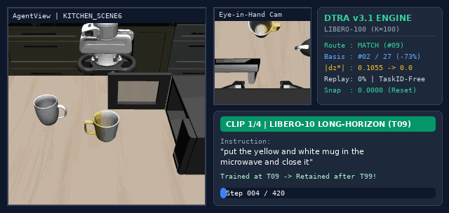
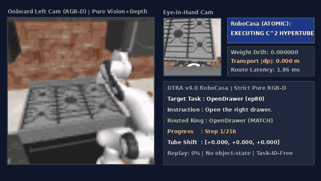

# DTRA: Dynamic Topology Ring Architecture

[English](README.md) | [한국어](README_KO.md)

[](dtra/paper_v2/DTRA_v3.0_Preprint.pdf)
[](dtra/paper_v2/dtra_preprint.pdf)
[](https://doi.org/10.5281/zenodo.24297711)
[](https://doi.org/10.5281/zenodo.24218482)
[](https://doi.org/10.5281/zenodo.24212130)
[](LICENSE)
[](https://www.python.org/downloads/)
[](https://pytorch.org/)

**Zero raw-demonstration replay, Task-ID-free continual visuomotor control with hyperspherical routing and shared motor bases (retaining lightweight $\le 96$-vector key-validation exemplars/task during registration): `87.00 ± 1.06%` final LIBERO-100 success across three training seeds (`ddof=1`, verified at `85.20 ± 0.43%` over 12,000 zero-retrain rollouts at `n_eval=20`, outperforming matched-encoder `DER++`, `L2P`, and `O-LoRA`).**

> **Repository Separation Note:** This repository tracks the full **ARIN $\to$ Drawing-VLA $\to$ ABK-VLA $\to$ DTRA v3.0–v6.0** research lineage across two generations:
> 1. **Gen 1 — `v1_drawing_vla` (`Drawing-VLA` v1.0.0 & `ABK-VLA` v1.1.3):** Closed-loop ACT sketch chunking ($K=16$, Catmull-Rom brush rendering in `Drawing-VLA`, DOI `10.5281/zenodo.24122154`) followed by clamped cubic B-Spline control-knot compression ($N_{\text{cp}}=6 \to H=16$), geometric DoG prototype routing, and continual 2D/3D benchmarks (`ABK-VLA`, DOI `10.5281/zenodo.24212130`).
> 2. **Gen 2 — `dtra` (**DTRA v3.0 — Dynamic Topology Ring Architecture**, corresponding to [`5Color/dtra`](https://github.com/5Color/dtra)):** Resolves Voronoi encroachment, duplicate-instruction routing collapse, and $O(K)$ task-specific head growth across $K=100$ sequential 7-DoF LIBERO tasks via $\mathbb{S}^{63}$ topological ring isolation, Two-Stage Top-$M$ CMC, `SharedBasisBank` ($100 \to 27$ frozen primitive bases, `-73%`), and Two-Timescale Snap-Back (`post_snap_norm = 0.0000`).
> 3. **Post-v3 Embodied Continual Tracks (`v4.0`–`v6.0`):** Strictly excluded from **DTRA v3.0** preprint tables and isolated under `dtra/experiments/{robocasa_v4,calvin_v4,calvin_v5}/` and `dtra/outputs/calvin_v6/` (archived alongside `outputs/{organ_v4,calvin_v4,calvin_v5,calvin_v6,robocasa}/`). Note that `v6.0`'s `OrganSystem2Planner` borrows the `Organ` name from **ARIN** as a lightweight System 2 routing prototype, distinct from the conceptual multi-ring $10^4\text{--}10^8$ `Organ` roadmap.

> **Inference-input scope:** Task-ID-free means no integer task index is passed to the policy at inference. Routing uses dual-camera features (plus depth in pure RGB-D tracks), proprioception, and a language embedding; evaluations that provide language commands are command-conditioned, not observation-only.

For the complete hypothesis-by-hypothesis chronology, see [**RESEARCH_LINEAGE.md**](RESEARCH_LINEAGE.md), [**RELEASE_NOTES_v3.1.0.md**](RELEASE_NOTES_v3.1.0.md) (prior: [v3.0.0](RELEASE_NOTES_v3.0.0.md)), [**dtra/README.md**](dtra/README.md), and [**dtra/PAPER_20P_OUTLINE.md**](dtra/PAPER_20P_OUTLINE.md).

---

## Hero Rollout & Continual Scaling (`LIBERO-100`, $K=100$)

| DTRA Elastic — Live Closed-Loop Rollouts from Saved $K=100$ Checkpoint (`Replay: 0%`) | 7-Arm Strict-Parity Scaling Benchmark (`K=10 -> 100`, Full `N=3` + `DER++/L2P/O-LoRA`) |
| :---: | :---: |
|  |  |
| **4 Verified 100%-Success Clips from One Frozen $K=100$ Policy (`Seed 42`):** `T09` (`libero_10` Kitchen Microwave — retained after 90 more tasks), **`T05` vs. `T87` (`Dup-Lang` Pair — identical prompt routed cleanly to `#05` vs. `#87` while reusing `Basis #04`)**, and `T67` (Living Room). **`87.00 ± 1.06%`** ($n=5$, $N=3$, `ddof=1`) \| **`85.20 ± 0.43%`** over **12,000 zero-retrain rollouts** ($n=20$, unseen `init[5:20]`: **`84.80 ± 0.44%`**). | Under identical frozen ResNet-18 parity, **DTRA Elastic (`87.00%`)** & **DTRA Rigid (`86.67%`)** compress 100 skills into **27 frozen bases (`-73%` basis slots / `-5.33%` total params)** with **`99.68%` Dup-Lang routing**, outperforming **Frozen MLP (`70.33%`)**, **ER 5% (`39.47%`)**, **DER++ (`38.40%`)**, **L2P (`1.20%`)**, and **O-LoRA (`1.00%`)**. |

---

## 1. Repository Structure

```text
drawing-vla/
├── README.md                              # Project landing page, 3-seed v3.0/v3.1 tables & reproduction guide
├── RELEASE_NOTES_v3.1.0.md                # Official DTRA v3.1.0 arXiv final release notes (23p, ddof=1)
├── RELEASE_NOTES_v3.0.0.md                # Prior DTRA v3.0.0 release notes & Zenodo DOI (10.5281/zenodo.24297711)
├── RESEARCH_LINEAGE.md                    # Gen-1 -> Gen-2 research chronology & milestone ledger
├── requirements.txt                       # Core Python dependencies
│
├── v1_drawing_vla/                        # [Gen 1 Archive] B-Spline Action Chunking & ABK-VLA
│   ├── src/                               # Early B-Spline policies, evaluators & CL experiments
│   ├── handvsai/                          # HandVsAI crowdsourced scoring & sketch templates
│   └── paper_v1/                          # ABK-VLA preprint PDF & v1 architecture specs
│
├── dtra/                                  # [Gen 2 Main Research] Dynamic Topology Ring Architecture
│   ├── assets/                            # Lightweight README preview GIFs (< 8 MB, 640x360 @ 12 fps)
│   ├── PAPER_20P_OUTLINE.md               # Initial 20-page NeurIPS/CoRL 1-col outline & v3.0/v4.0 boundary spec
│   ├── core/
│   │   ├── bspline_core.py                # Frozen clamped C^2 cubic B-Spline basis decoder (N_cp=6 [2D/Meta-World] or N_cp=8 [7-DoF LIBERO] -> H=16)
│   │   ├── hypertube_transport.py         # [v4.0+ Track] Object-centric C^2 hypertube transport adapter
│   │   ├── sim_dtra_tube_dynamics.py      # HypertubeRingLayer, TwoStageDTRA & 6 invariant checks
│   │   └── topological_bridge.py          # C^2 geodesic bridge & myelinated transition graph core
│   ├── experiments/
│   │   ├── libero/                        # [v3.0] LIBERO-Goal (K=5) & LIBERO-100 (K=100) harness
│   │   ├── metaworld/                     # [v3.0] 8-task 3D Meta-World 3-seed 6-arm ablation & OOD suite
│   │   ├── calvin_v4/, calvin_v5/         # [Post-v3 Track] CALVIN 34-task System 1 & Z-gating anchors
│   │   └── robocasa_v4/                   # [Post-v3 Track] RoboCasa 12-task pure RGB-D kitchen CL
│   ├── outputs/
│   │   └── calvin_v6/                     # [Post-v3 Track] CALVIN v6 System 1+2 JSONs, HUD & scope notes
│   ├── visualization/
│   │   └── visualize_dtra_xai.py          # Generates 300 DPI architecture, OOD, manifold & telemetry figures
│   ├── README.md                          # DTRA package overview (English)
│   ├── README_KO.md                       # DTRA package overview (Korean)
│   └── paper_v2/
│       ├── DTRA_v3.0_Preprint.pdf         # Final 23-page DTRA preprint (XeTeX build, >=8pt tables)
│       ├── dtra_preprint.pdf              # Final 23-page clean ASCII arXiv build (pdfLaTeX/XeTeX safe)
│       ├── dtra_arxiv_submission.tar.gz   # Standalone arXiv source submission bundle (verified build)
│       ├── dtra_v3.0_preprint.tex         # XeTeX 23-page LaTeX source
│       ├── dtra_preprint.tex              # Pure ASCII 23-page arXiv LaTeX source
│
├── outputs/
│   ├── libero/                            # Locked LIBERO-100 3-seed JSONs (42, 100, 2026) & LIBERO-Goal pilot
│   ├── metaworld/                         # Meta-World 3-seed & supplemental JSON results + checkpoints
│   ├── figures/                           # 300 DPI publication figures (fig0 .. fig8)
│   ├── calvin_v4/, calvin_v5/, calvin_v6/, organ_v4/, robocasa/  # [Post-v3 Track] Isolated A6000 archives
│   └── v1_archive/                        # Archived Gen-1 benchmark plots & JSON logs
│
├── scripts/
│   ├── build_dtra_v3_paper.py             # Generates 23-page LaTeX + compiles both PDFs
│   ├── generate_libero100_figures.py      # Generates 300 DPI fig6, fig7 (3-seed ddof=1 error bars) & fig8
│   ├── summarize_libero_multiseed.py      # Prints finalized K=10..100 multi-seed Mean ± Sample Std (ddof=1) tables
│   └── sync_remote_dtra.py, check_remote_env.py
│
└── tests/                                 # Automated invariance & v3.0 module verification suite
```

---

## 2. Verified DTRA v3.0 / v3.1 Benchmark Results (`LIBERO-100` & `Meta-World` Only)

### A. LIBERO-100 (`libero_10 + libero_90`, $K=10 \to 100$) Multi-Seed & External CL Summary (Strict Encoder Parity)

All parity arms share identical frozen perception (`ResNet-18` `L1–L3` DualCam + proprioception) and `LightweightTextEncoder` with DTRA Elastic peak VRAM of `2,713 ± 94 MB` (`n_eval=5` per task at each milestone, Mean ± Sample Std **`ddof=1`** across all tables). All four core arms cover **complete `N=3` training seeds `{42, 100, 2026}`**, complemented by matched-encoder published continual learning baselines (`DER++`, `L2P`, `O-LoRA`) on Seed `42`:

| Arm (Strict Parity) | $K=10$ SR | $K=30$ SR | $K=50$ SR | $K=70$ SR | **$K=100$ SR $\uparrow$** | FR $\downarrow$ | BWT $\uparrow$ | RouteAcc $\uparrow$ | Dup-Lang Route $\uparrow$ | Bases ($K=100$) | Active Latency |
| :--- | :---: | :---: | :---: | :---: | :---: | :---: | :---: | :---: | :---: | :---: | :---: |
| `arm_frozen_mlp` ($N=3$) | `82.00±5.29%` | `85.11±3.42%` | `79.07±0.61%` | `76.48±1.19%` | `70.33 ± 1.45%` | `2.90±1.28%` | `+0.20±2.81%` | `81.94±0.29%` | `41.76 ± 2.56%` | `100` | `6.46±0.70 ms` |
| `arm_er_5pct` ($N=3$) | `58.67±6.11%` | `56.67±8.19%` | `52.00±5.41%` | `47.43±4.98%` | `39.47 ± 1.81%` | `26.33±4.24%` | `-20.00±3.17%` | `---` | `---` | `1` | **`4.93±0.72 ms`** |
| `arm_dtra_rigid` ($N=3$) | **`83.33±2.31%`** | `90.44±1.02%` | **`90.67±1.15%`** | `87.52±0.87%` | `86.67 ± 0.81%` | **`2.56±1.11%`** | **`+0.67±1.35%`** | **`99.91±0.16%`** | **`99.68 ± 0.55%`** | **`27`** | `8.70±1.14 ms` |
| **`arm_dtra_elastic` ($N=3$, Full)** | `80.00±2.00%` | **`91.11±1.68%`** | **`90.67±1.22%`** | **`87.71±0.86%`** | **`87.00 ± 1.06%`** | `2.69±0.82%` | `+0.20±0.88%` | `99.90±0.16%` | **`99.68 ± 0.55%`** | **`27`** | `9.55±0.24 ms` |
| `DER++` (5% Buf. + Distill., Seed 42) | `68.00%` | `60.00%` | `60.40%` | `51.71%` | `38.40%` | `29.70%` | `-16.16%` | `---` | `---` | `1` | `5.49 ms` |
| `L2P` (Prompt Pool, Seed 42) | `8.00%` | `2.00%` | `1.60%` | `1.14%` | `1.20%` | `51.72%` | `-51.72%` | `---` | `---` | `32` | `7.79 ms` |
| `O-LoRA` (Ortho Subspace, Seed 42) | `2.00%` | `1.33%` | `2.00%` | `1.14%` | `1.00%` | `42.63%` | `-42.63%` | `---` | `---` | `100` | `7.05 ms` |

- **Per-Seed K=100 Breakdown (`N=3` Complete, Sample Std `ddof=1`):**
  - `arm_dtra_elastic`: Seed 42 **`87.80%`**, Seed 100 **`87.40%`**, Seed 2026 **`85.80%`** $\rightarrow$ Mean **`87.00 ± 1.06%`** (`+16.67 pp` SR and `+57.93 pp` Dup-Lang routing over `arm_frozen_mlp`, `27` frozen shared bases = **73% basis-slot / 5.33% total parameter reduction**).
  - `arm_dtra_rigid`: Seed 42 `86.20%`, Seed 100 `86.20%`, Seed 2026 `87.60%` $\rightarrow$ Mean `86.67 ± 0.81%`.
  - `arm_frozen_mlp`: Seed 42 `72.00%`, Seed 100 `69.60%`, Seed 2026 `69.40%` $\rightarrow$ Mean `70.33 ± 1.45%`.
  - `arm_er_5pct`: Seed 42 `40.20%`, Seed 100 `40.80%`, Seed 2026 `37.40%` $\rightarrow$ Mean `39.47 ± 1.81%`.

#### Zero-Retrain Extended Initial-State Verification (`n_eval=20`, **12,000 Total Rollouts**)

Evaluating all three saved $K=100$ checkpoints (`Seeds 42, 100, 2026`) across `20` initial states/task (`6,000` rollouts/arm, `12,000` total; [`eval_libero100_extended_neval20.json`](outputs/libero/eval_libero100_extended_neval20.json); Mean ± Sample Std `ddof=1`) confirms zero overfitting to `init[0:5]`:

| Saved $K=100$ Policy ($N=3$) | `init[0:5]` | **Unseen Held-Out `init[5:20]` [95% Wilson CI]** | **All `init[0:20]` [95% Wilson CI]** | **Dup-Lang SR (Route)** | Unique-Lang SR |
| :--- | :---: | :---: | :---: | :---: | :---: |
| `arm_frozen_mlp` (`6,000` rollouts) | `70.00 ± 0.92%` | `68.82 ± 0.91%` `[67.5, 70.2]` | `69.12 ± 0.90%` `[67.9, 70.3]` | `36.33%` (`41.80%`) | `83.17%` |
| **`arm_dtra_elastic` (`6,000` rollouts)** | **`86.40 ± 1.06%`** | **`84.80 ± 0.44%` `[83.7, 85.8]`** | **`85.20 ± 0.43%` `[84.3, 86.1]`** | **`89.06%` (`99.94%`)** | **`83.55%`** |
| **Gain ($\Delta$ DTRA $-$ MLP)** | **`+16.40 pp`** | **`+15.98 pp`** | **`+16.08 pp`** | **`+52.72 pp` (`+58.14 pp`)** | `+0.38 pp` |

### B. 3D Meta-World (`8` Tasks, 3-Seed Causal Ablation & External CL, `ddof=1`) & `LIBERO-Goal` (`5` Tasks)

| Benchmark | Arm / Mode | Clean / Mean SR | FR $\downarrow$ | RouteAcc | Severe OOD ($\sigma=0.20$) / Peak VRAM | Source |
| :--- | :--- | :---: | :---: | :---: | :---: | :--- |
| **Meta-World (8 Tasks, 3 Seeds)** | `arm4_frozen_mlp_multimodal` | `85.6 ± 3.8%` | **`0.0 ± 0.0%`** | **`100.0%`** | `23.6 ± 4.8%` OOD SR | [`ablate_dtra_scientific_results.json`](outputs/metaworld/ablate_dtra_scientific_results.json) |
| **Meta-World (8 Tasks, 3 Seeds)** | **`arm6_dtra_full_multimodal` (Feat-Reg)** | `72.2 ± 8.3%` | **`0.0 ± 0.0%`** | **`100.0%`** | **`51.4 ± 5.4%` OOD SR** (`1.87 ms` $O(1)$ CPU) | [`ablate_dtra_scientific_results.json`](outputs/metaworld/ablate_dtra_scientific_results.json) |
| **Meta-World Causal (3 Seeds)** | **`DTRA Full (No Feat-Reg, p=0, σ=0)`** | `83.1 ± 6.3%` | **`0.0 ± 0.0%`** | **`100.0%`** | `45.0 ± 6.6%` OOD SR | [`ablate_dtra_v31_final_results.json`](outputs/metaworld/ablate_dtra_v31_final_results.json) |
| **Meta-World Causal (3 Seeds)** | `Frozen MLP + Conv4 Feat-Reg` | **`90.8 ± 3.6%`** | **`0.0 ± 0.0%`** | **`100.0%`** | `49.2 ± 10.1%` OOD SR | [`ablate_dtra_v31_final_results.json`](outputs/metaworld/ablate_dtra_v31_final_results.json) |
| **Meta-World External CL (3 Seeds)** | `DER++` / `L2P` / `O-LoRA` | `73.3%` / `16.7%` / `7.2%` | `22.9%` / `79.4%` / `63.2%` | `---` | `13.6%` / `17.5%` / `9.4%` OOD SR | [`ablate_dtra_v31_final_results.json`](outputs/metaworld/ablate_dtra_v31_final_results.json) |
| **Meta-World Reverse ($T_7 \to T_0$, Seed 42)** | `arm6_dtra_full_multimodal` | `74.2%` | **`0.0%`** | **`100.0%`** | `64.2%` OOD SR | [`ablate_dtra_supplemental_results.json`](outputs/metaworld/ablate_dtra_supplemental_results.json) |
| **LIBERO-Goal Pilot (5 Tasks, Seed 42)** | **`arm_dtra_elastic`** | `92.0%` | `5.0%` | **`100.0%`** | `3,696 MB` VRAM (`post_snap_norm = 0.0`) | [`libero_goal_pilot_4arms.json`](outputs/libero/libero_goal_pilot_4arms.json) |


### Evaluation scope and resource interpretation

All four core LIBERO-100 arms (`Frozen MLP`, `ER 5%`, `DTRA Rigid`, `DTRA Elastic`) cover three training seeds (`42, 100, 2026`, unified sample std `ddof=1`); mid-stream checkpoints use `n_eval=5` rollouts/task, while final $K=100$ generalization for `DTRA Elastic` vs. `Frozen MLP` is verified across all three seeds over `n_eval=20` initial states (`12,000` rollouts total, including `15` unseen held-out initial states `init[5:20]` with descriptive pooled 95% Wilson CIs). Matched-encoder external baselines (`DER++`, `L2P`, `O-LoRA`) evaluate Seed 42 on LIBERO-100 and all three seeds on Meta-World.

Parameter freezing ($\nabla_\theta=0$) and temporary state reset are separate: on LIBERO-100, `episode_snap_back()` clears routing inertia and write-only diagnostic buffers (`post_snap_norm = 0.0000`, so `chunk_snap_back()` does not alter forward control outputs); active per-chunk `snap_back()` applies to Meta-World. LIBERO-100 empirical success-rate forgetting is **2.69 ± 0.82%** (`DTRA Elastic`) and **2.56 ± 1.11%** (`DTRA Rigid`).

The **73% reduction concerns motor basis slot count** (`100 -> 27` frozen bases, `3.81 MB` vs. `14.12 MB` unshared). Because per-task `LIBEROHypertubeNode` adapters occupy `179.33 MB` (`97.92%` of total policy memory), `SharedBasisBank` yields a **5.33% total policy-parameter reduction** (`193.45 -> 183.14 MB`, vs. `151.67 MB` for Frozen MLP and `1.70–2.09 MB` for monolithic baselines, excluding the common frozen backbone and non-parameter buffers).

On Meta-World, our three-seed causal ablation (`ablate_dtra_v31_final.py`, `ddof=1`) isolates the clean-versus-OOD trade-off: removing Conv4 feature-noise regularization (`p=0, σ=0`) lifts DTRA Full from `72.2 ± 8.3%` to **`83.1 ± 6.3%` clean SR** (`+10.8 pp` unrounded) while preserving **`45.0 ± 6.6%` severe OOD SR** (vs. unregularized Frozen MLP's `23.6 ± 4.8%`). Broad retrieval remains $O(K)$, with a constant-cost selected decoding core (`9.55 ± 0.24 ms` GPU policy inference at $K=100$).

### C. Post-v3 Embodied Continual Tracks (`DTRA v4.0 – v6.0`, Separate from Preprint)

| Track / Benchmark | Arm / Mode | Key Metrics | Drift | Source |
| :--- | :--- | :--- | :---: | :--- |
| **v4.0 RoboCasa (`12` Tasks: `8` Atomic + `4` Composite, `0%` Replay)** | `Arm4_DTRA_v4_Hypertube` (vs `Flat_MLP`/`ER_5%` `0.00%`) | Atomic SR **`29.17%`** (`OpenMicrowave 100.0%`), Overall `19.44%`, RouteAcc **`100.0%`**, BWT `+0.00%`, `1.928 ms` *(Composite `0.00%` $\rightarrow$ System 2 motivation)* | `0.000000` | [`robocasa_continual_results_4arms.json`](dtra/experiments/robocasa_v4/robocasa_continual_results_4arms.json) |
| **v5.0 + v6.0 CALVIN (`34` Tasks, `30` 5-Step Chains)** | `Pure Vision` (`Leak: ZERO`) | RouteAcc **`97.65%`**, Single SR `55.88%`, 5-Chain Len **`2.37`** *(vs `1.90`)*, 5/5 SR **`16.67%`** *(vs `6.67%`)*, Jerk **`+15.12%`**, `22` edges, `9.30 ms` | **`0.0000`** | [`calvin_v6_vision_34tasks.json`](dtra/outputs/calvin_v6/calvin_v6_vision_34tasks.json) |
| **v5.0 + v6.0 CALVIN (`34` Tasks, `30` 5-Step Chains)** | `Oracle Anchor` *(Upper-Bound Ref)* | RouteAcc `97.65%`, Single SR `46.47%`, 5-Chain Len `2.53` *(vs `1.90`)*, 5/5 SR `16.67%` *(vs `10.00%`)*, Jerk `+15.24%`, `25` edges, `8.49 ms` | `0.0000` | [`calvin_v6_oracle_34tasks.json`](dtra/outputs/calvin_v6/calvin_v6_oracle_34tasks.json) |

<details>
<summary><strong>Expand Post-v3 Embodied Rollout Previews (CALVIN v6 Pure Vision & RoboCasa v4 Pure RGB-D)</strong></summary>

| DTRA v6.0 — CALVIN Pure Vision 5-Step Chain (`System 1 + System 2`) | DTRA v4.0 — RoboCasa Pure RGB-D Kitchen (`Hypertube Transport`) |
| :---: | :---: |
|  |  |
| Canonical `5/5` sequence (`Chain #1`, `Mode: VISION`, `Leak: ZERO`, `Drift: 0.0000`, live System 2 recovery `CELL #108 -> #100`). ([Scope Notes](dtra/outputs/calvin_v6/BENCHMARK_SCOPE_AND_LIMITATIONS.md)) | 12 tasks (`8` Atomic + `4` Composite, `0%` replay, no `object-state`, `Drift: 0.000000`). ([Results JSON](dtra/experiments/robocasa_v4/robocasa_continual_results_4arms.json)) |

</details>

---

## 3. Reproduction and Code Availability

Core DTRA modules, unit tests, figure/paper build scripts, locked result JSONs, and the Meta-World / LIBERO / post-v3 benchmark scripts are included in this repository. Installing `requirements.txt` covers the core modules, unit tests, and figure/LaTeX regeneration scripts; full simulator rollouts additionally require installing the external simulation packages (`metaworld`, `mujoco`, `gymnasium` for Meta-World; `libero`, `robosuite`, `bddl`, `h5py`, and LIBERO HDF5 demos for LIBERO-100). Use `python scripts/check_remote_env.py` to inspect which simulator dependencies are available in your environment.

```bash
# 0. Install core dependencies, inspect environment & run invariant unit tests
pip install -r requirements.txt
python scripts/check_remote_env.py --env dtra
python -m unittest discover -s tests -v
python dtra/tests/test_topological_bridge.py

# 1. Step-1 Hypertube manifold invariants (6 automated checks)
python dtra/core/sim_dtra_tube_dynamics.py

# 2. 3D Meta-World 8-task 3-seed scientific ablation & supplemental stress suite (requires metaworld/mujoco)
python -m dtra.experiments.metaworld.ablate_dtra_scientific --seeds 42 100 2026 --epochs 55
python -m dtra.experiments.metaworld.ablate_dtra_supplemental --seed 42 --epochs 55

# 3. LIBERO-100 (K=100) continual scaling stream (requires `libero` conda env + LIBERO HDF5 demos)
python -m dtra.experiments.libero.benchmark_dtra_libero \
  --suites libero_10,libero_90 --max-tasks 100 \
  --stream-tasks --eval-milestones 10,30,50,70,100 \
  --epochs 25 --batch-size 128 --n-eval 5 --seed 42 \
  --out-json outputs/libero/benchmark_dtra_libero_10_libero_90_k100.json

# 4. Aggregate 3-seed tables, regenerate 300 DPI figures & compile 23-page DTRA PDFs
python scripts/summarize_libero_multiseed.py
python scripts/generate_libero100_figures.py
python scripts/build_dtra_v3_paper.py
```

---

## 4. Visual Figures (`outputs/figures/`) & Preprints (`dtra/paper_v2/`)

- **23-Page Final Preprints & arXiv Source Bundle:** [`dtra/paper_v2/DTRA_v3.0_Preprint.pdf`](dtra/paper_v2/DTRA_v3.0_Preprint.pdf) | [`dtra/paper_v2/dtra_preprint.pdf`](dtra/paper_v2/dtra_preprint.pdf) (Clean ASCII arXiv, 23p) | [`dtra/paper_v2/dtra_preprint.tex`](dtra/paper_v2/dtra_preprint.tex) | [`dtra_arxiv_submission.tar.gz`](dtra/paper_v2/dtra_arxiv_submission.tar.gz)
- **v3.0 Scaling & Architecture Figures:** [`fig6_dtra_v3_architecture_schematic.png`](outputs/figures/fig6_dtra_v3_architecture_schematic.png) | [`fig7_libero100_scaling_curves.png`](outputs/figures/fig7_libero100_scaling_curves.png) | [`fig8_libero100_basis_and_callstack.png`](outputs/figures/fig8_libero100_basis_and_callstack.png)
- **Meta-World XAI Figures:** [`fig0`](outputs/figures/fig0_dtra_architecture_schematic.png), [`fig1`](outputs/figures/fig1_ood_perturbation_curves.png), [`fig2`](outputs/figures/fig2_manifold_elastic_snapback.png), [`fig3`](outputs/figures/fig3_xai_telemetry_rollout.png), [`fig4`](outputs/figures/fig4_cl_forgetting_heatmap_and_bars.png), [`fig5`](outputs/figures/fig5_o1_latency_scaling.png)

---

## 5. Citation & License

```bibtex
@misc{son2026dtra,
  author       = {Son, Seungjoon},
  title        = {{DTRA}: Dynamic Topology Ring Architecture for Replay-Free Continual Visuomotor Control via Hyperspherical Isolation and Shared Motor Bases},
  year         = {2026},
  month        = nov,
  publisher    = {Zenodo},
  doi          = {10.5281/zenodo.24297711},
  url          = {https://doi.org/10.5281/zenodo.24297711},
  note         = {v3.1.0 23-page Preprint (v3.0.0 Zenodo archive); Concept DOI: 10.5281/zenodo.24218482; prior v2.1.0: 10.5281/zenodo.24218483; Repository: \url{https://github.com/5Color/dtra}}
}

@misc{son2026abkvla,
  author       = {Son, Seungjoon},
  title        = {{ABK-VLA}: Task-ID-Free Continual Visuomotor Policy Learning via Autonomous B-Spline Knot Compression and Visual Prototype Routing},
  year         = {2026},
  month        = nov,
  publisher    = {Zenodo},
  doi          = {10.5281/zenodo.24212130},
  url          = {https://doi.org/10.5281/zenodo.24212130},
  note         = {v1.1.3; v1.1.1: 10.5281/zenodo.24208545; Concept DOI: 10.5281/zenodo.24208544}
}
```

Released under the [MIT License](LICENSE).
