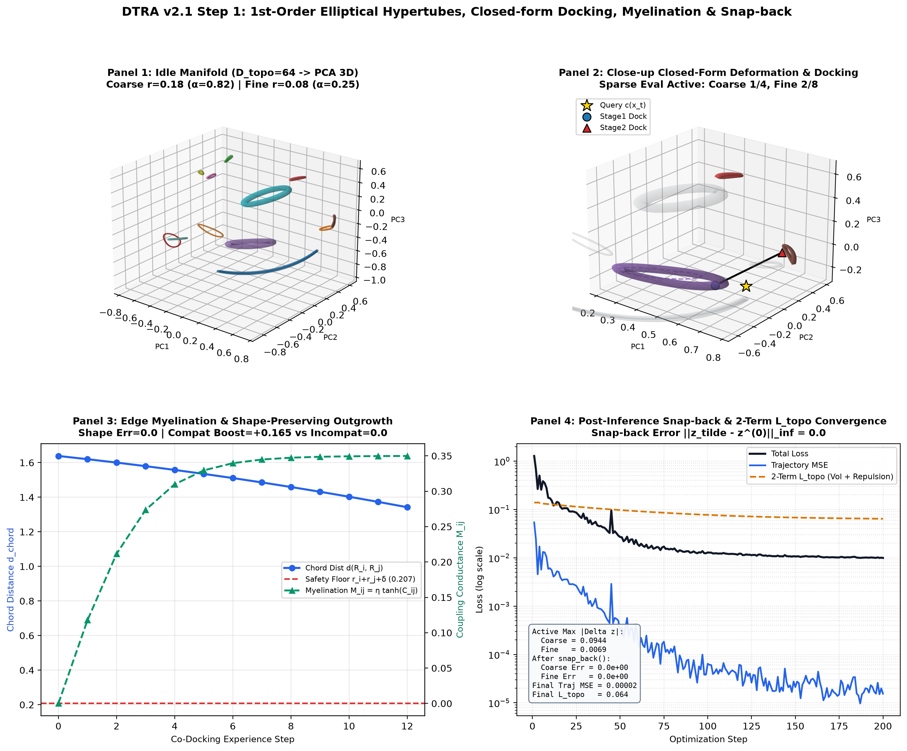
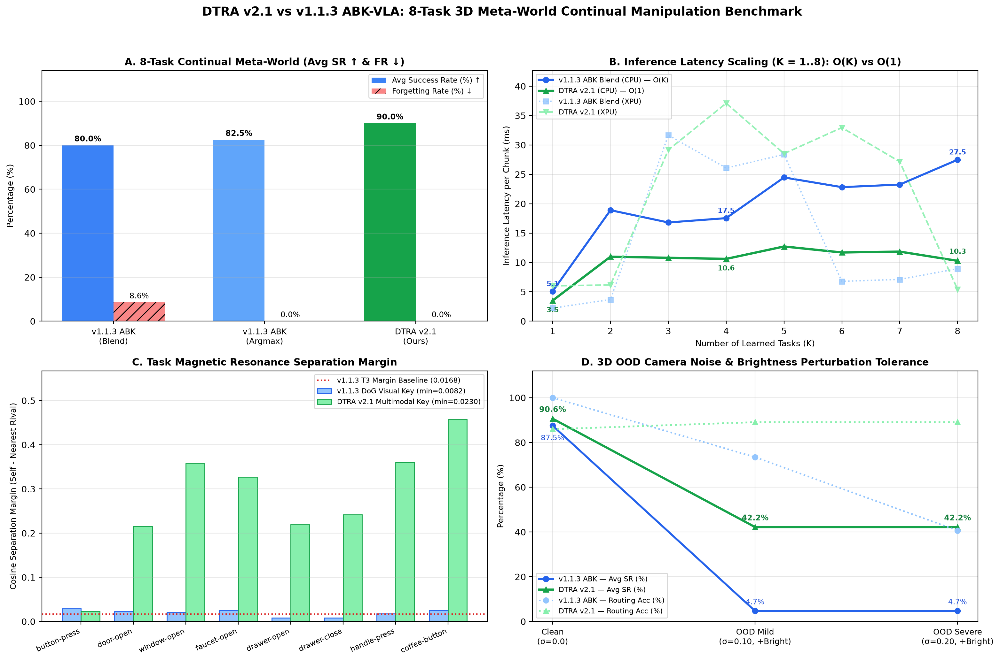

# DTRA: Real-Time Continual 3D Manipulation via Two-Stage Docking and Elastic Snap-Back of Hypertube Rings

[](paper_dtra/DTRA_Preprint.pdf)
[](paper_dtra/dtra_v21_preprint.tex)
[](docs/DTRA_v2_Spec.md)
[](https://github.com/5Color/abk-vla)
[](https://doi.org/10.5281/zenodo.24208545)
[](LICENSE)

Official implementation and preprint for **DTRA** (*Dynamic Topological Ring Architecture*), a non-destructive, task-ID-free continual visuomotor manipulation framework. Building upon our prior baseline architecture ([`5Color/abk-vla`](https://github.com/5Color/abk-vla), v1.1.3 [`paper/ABK_VLA_Preprint.pdf`](paper/ABK_VLA_Preprint.pdf)), **DTRA** resolves $O(K)$ residual inference growth, $t=0$ visual key collisions on symmetric tabletop initializations, and high-pass camera noise fragility across 8 sequential 3D manipulation tasks.

---

## 1. Core Architecture Overview

* **First-Order Elliptical Hypertubes on $\mathbb{S}^{63}$ (`D_topo = 64`):**
  Every motor primitive $R_i$ is represented as a closed first-order harmonic orbit on the unit hypersphere using the periodic basis $B_{\text{ring}}(\theta) = [1, \cos\theta, \sin\theta]^\top$, parameterized by learnable attraction radius $r_i = \mathrm{softplus}(\rho_i) + 10^{-3}$, bounded elastic compliance $\alpha_i = \sigma(\omega_i) \in (0, 1)$, and adaptive magnetic gate $\tau_i = \mathrm{softplus}(\beta_i)$. Incoming topological queries $\mathbf{c}_t \in \mathbb{S}^{63}$ locate the exact nearest ring point in $O(1)$ via closed-form analytical `atan2` phase projection under spherical chord distance $d_{\text{chord}}$.
* **Multimodal Visual-Language Magnetic Keys (`D_key = 128`):**
  Replaces sensitive `15x15` Difference-of-Gaussians (DoG) visual prototypes with normalized multimodal query vectors $\mathbf{x}_t = \mathrm{norm}([0.55\,\mathbf{v}_t ; 0.835\,\ell_{\text{task}}]) \in \mathbb{S}^{127}$ combining frozen mid-level Conv4 spatial features and deterministic `LightweightTextEncoder` instructions (`13.9x` wider mean inter-task cosine separation margin).
* **Two-Stage Coarse-to-Fine Docking ($O(\lvert A_t \rvert) \approx O(1)$):**
  Stage-1 thick, compliant Coarse rings emit base cubic B-Spline anchor control points $\mathbf{P}_{\text{anchor}}$ and context shift $\mathbf{c}_{\text{ctx}}$; Stage-2 thin, stiff Fine rings refine $6$-mode Winner-Takes-All (WTA) control-point residuals $\Delta\mathbf{P}_{m^*}$ decoded through a frozen clamped cubic B-Spline basis (`N_k = 6` knots $\to$ $H = 16$ continuous trajectory steps, `exec_steps = 8`). During evaluation, only gated active tubes $i \in A_t$ are executed.
* **Command-Compatible Myelination ($M_{ij}$) & Elastic Snap-Back (`snap_back()`):**
  Unified magnetic attraction combines intra-episode inertia ($\eta\, o_{i,t-1}$) with symmetric Hebbian myelinated conductance $M_{ij}$ gated by command compatibility $\max(0, \cos(\mathbf{x}_t, \mathbf{k}_i))$, delivering `+0.165` associative recall acceleration while blocking incompatible queries to `0.0`. Immediately after chunk synthesis, `snap_back()` clears temporary deformations $\Delta\mathbf{z}_i \leftarrow \mathbf{0}$ (`L_inf = 0.0`), and `reset()` clears cross-chunk buffers at episode boundaries.

---

## 2. Verified Experimental Results

### Step 1: Topological & Dynamical Verification on $\mathbb{S}^{63}$ (`TwoStageDTRA`)



| Invariant Check | Verified Quantitative Outcome |
| :--- | :--- |
| **1. Differentiable Gradient Flow** | Zero `NaN`/`Inf` gradients across `rho`, `omega(alpha)`, `beta`, and `proj_topo` |
| **2. Zero-Forgetting Snap-Back** | Active $L_\infty$ deform `0.094370` (Coarse), `0.006922` (Fine) $\to$ post-`snap_back()` error **`0.0`** |
| **3. Episode Lifecycle `reset()`** | Cross-chunk inertia `(0.2581, 0.0100)`, boost `(+0.0645, +0.0025)` $\to$ post-`reset()` **`0.0`** |
| **4. Sparse $O(\lvert A_t \rvert)$ Eval Slicing** | Train soft tail `4/4 (100.0%)`, `8/8 (100.0%)` $\to$ Eval **`1/4 (25.0%)`**, **`2/8 (25.0%)`** |
| **5. Two-Term $\mathcal{L}_{\text{topo}}$ (`200` steps)** | Total Loss `1.2766 -> 0.0099`; Traj MSE `0.05399 -> 0.00002`; Coarse `r=0.1832, alpha=0.8225`; Fine `r=0.0829, alpha=0.2488` |
| **6. Myelination & Outgrowth** | Drift `(shape, r, alpha) = (0.0, 0.0, 0.0)`; $d_{\text{chord}}: 1.6385 \to 1.3422$ (safety floor `0.2073`); Compat **`+0.1648`** (`+0.165`) vs. Incompat **`0.0`** |

---

### Step 2: 8-Task 3D Meta-World Continual Benchmark (`DTRA (v2.1)` vs. `ABK-VLA v1.1.3`)



Evaluated sequentially over $K = 8$ MuJoCo `ML1 v3` tasks (`128x128` corner RGB + 4-DoF proprioceptive state, `30` demos/task, `55` epochs, `seed = 42`, `n_eval = 15` held-out episodes per task, `n_ood_eval = 8`):

| Method | Params | `button-press` ($T_0$) | `door-open` ($T_1$) | `window-open` ($T_2$) | `faucet-open` ($T_3$) | `drawer-open` ($T_4$) | `drawer-close` ($T_5$) | `handle-press` ($T_6$) | `coffee-button` ($T_7$) | **Avg SR ↑** | **FR ↓** | **BWT ↑** |
| :--- | :---: | :---: | :---: | :---: | :---: | :---: | :---: | :---: | :---: | :---: | :---: | :---: |
| `v1.1.3 ABK (Blend)` | 2,943,031 | **100.0%** | **93.3%** | **73.3%** | **100.0%** | 53.3% | 73.3% | 93.3% | 53.3% | 80.0% | 8.57% | -5.71% |
| `v1.1.3 ABK (Argmax)` | 2,943,031 | **100.0%** | 86.7% | 66.7% | **100.0%** | 53.3% | 80.0% | 93.3% | 80.0% | 82.5% | **0.00%** | **0.00%** |
| **DTRA (v2.1, Ours)** | 5,248,288 | 93.3% | 80.0% | 66.7% | **100.0%** | **93.3%** | **100.0%** | **100.0%** | **86.7%** | **90.0%** | **0.00%** | **0.00%** |

| Efficiency, Resonance & 3D OOD Stress Metric | `v1.1.3 ABK (Blend)` | **DTRA (v2.1, Ours)** | Improvement |
| :--- | :---: | :---: | :---: |
| **CPU Inference Latency ($K=1 \to K=4 \to K=8$)** | `5.08 -> 17.54 -> 27.48 ms` ($O(K)$) | **`3.51 -> 10.61 -> 10.28 ms`** ($O(1)$) | **`2.67x` faster at $K=8$** |
| **Magnetic Resonance Cosine Margin (Mean / Min)** | `0.0198` / `0.0082` | **`0.2752`** / **`0.0230`** | **`13.9x` wider mean margin** |
| **3D OOD Avg SR (Clean / Mild $\sigma=0.10$ / Severe $\sigma=0.20$)** | `87.5%` / `4.7%` / `4.7%` | **`90.6%` / `42.2%` / `42.2%`** | **`9x` higher Severe OOD SR** |
| **3D OOD Severe Routing Accuracy ($\sigma=0.20$, Bright `1.25x+0.12`)** | `40.6%` | **`89.1%`** | **`+48.5%p` routing retention** |

---

## 3. Environment Setup & Reproducibility

### Installation

```bash
git clone https://github.com/5Color/dtra.git
cd dtra

# Core dependencies (Step 1 topological simulation & frozen B-Spline unit tests)
pip install -r requirements.txt

# Optional dependencies for 8-task 3D Meta-World continual manipulation (MuJoCo)
pip install "gymnasium>=1.0" "mujoco>=3.3" "metaworld>=3.1"
```

### Run Verification, Benchmarks & Unit Tests

```bash
# 1. Step 1 hypertube dynamics 6-point verification + PCA figure generation
python experiments/sim_dtra_tube_dynamics.py
python experiments/sim_dtra_tube_dynamics.py --ko        # Korean diagnostic figure

# 2. Full 8-task 3D Meta-World continual benchmark (55 epochs, 30 demos, seed=42)
python experiments/benchmark_dtra_3d_metaworld.py --epochs 55 --n-demos 30 --n-eval 15 --n-ood-eval 8 --seed 42

# 3. Regenerate 4-panel benchmark plot cleanly from cached JSON metrics
python experiments/benchmark_dtra_3d_metaworld.py --plot-only

# 4. Run core B-Spline & policy unit test suite (44 tests)
python -m unittest discover -s tests -v
```

---

## 4. Repository Layout

| Path | Role |
| :--- | :--- |
| [`paper_dtra/DTRA_Preprint.pdf`](paper_dtra/DTRA_Preprint.pdf) | Final 7-page **DTRA** preprint PDF (mirror of [`dtra_v21_preprint.pdf`](paper_dtra/dtra_v21_preprint.pdf)) |
| [`paper_dtra/dtra_v21_preprint.tex`](paper_dtra/dtra_v21_preprint.tex) | Two-column LaTeX source for the DTRA preprint |
| [`docs/DTRA_v2_Spec.md`](docs/DTRA_v2_Spec.md) | Formal mathematical specification & variable glossary (v2.1) |
| [`experiments/sim_dtra_tube_dynamics.py`](experiments/sim_dtra_tube_dynamics.py) | `HypertubeRingLayer`, `TwoStageDTRA`, 6 automated invariant checks & Step-1 figure |
| [`experiments/benchmark_dtra_3d_metaworld.py`](experiments/benchmark_dtra_3d_metaworld.py) | `DTRA3DPolicy`, `LightweightTextEncoder`, `HypertubeNode`, `CoarseAnchorHead` & 8-task harness |
| [`outputs/dtra_3d_metaworld_benchmark.json`](outputs/dtra_3d_metaworld_benchmark.json) | Raw metrics, $8 \times 8$ accuracy matrices, CPU/XPU latency sweeps, margins & OOD logs |
| [`tools/bspline_core.py`](tools/bspline_core.py), [`tests/`](tests/) | Frozen clamped cubic B-Spline trajectory decoder and core unit test suite |
| [`paper/ABK_VLA_Preprint.pdf`](paper/ABK_VLA_Preprint.pdf) | Baseline ABK-VLA v1.1.3 preprint (preserved intact for direct comparison) |

---

## 5. Citation

If you find **DTRA** or our prior **ABK-VLA** foundation useful in your research, please cite:

```bibtex
@article{son2026dtra,
  author       = {Son, Seungjoon},
  title        = {DTRA: Real-Time Continual 3D Manipulation via Two-Stage Docking and Elastic Snap-Back of Hypertube Rings},
  year         = {2026},
  month        = nov,
  journal      = {Preprint},
  url          = {https://github.com/5Color/dtra}
}

@misc{son2026abkvla,
  author       = {Son, Seungjoon},
  title        = {ABK-VLA: Task-ID-free Continual Visuomotor Policy Learning via Autonomous B-Spline Knot Compression and Visual Prototype Routing},
  year         = {2026},
  month        = nov,
  publisher    = {Zenodo},
  doi          = {10.5281/zenodo.24208545},
  url          = {https://doi.org/10.5281/zenodo.24208545}
}
```

## License

Released under the [MIT License](LICENSE).
