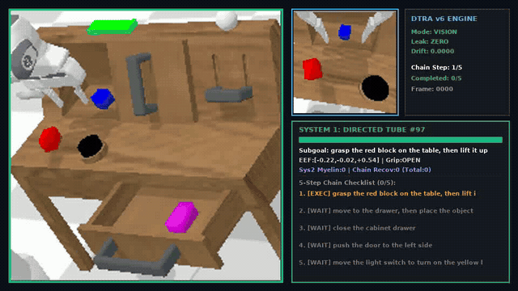
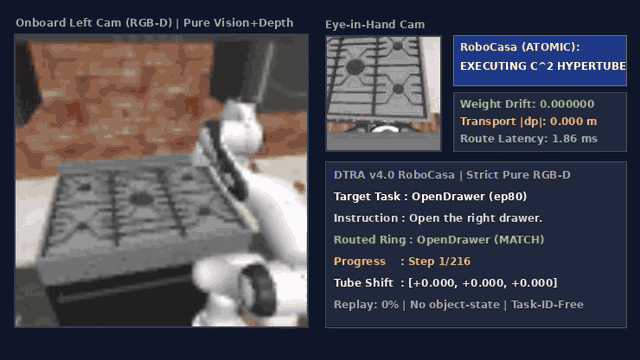

# DTRA: Dynamic Topology Ring Architecture

[English](README.md) | **한국어**

[](dtra/paper_v2/DTRA_v3.0_Preprint.pdf)
[](dtra/paper_v2/dtra_preprint.pdf)
[](https://doi.org/10.5281/zenodo.24297711)
[](https://doi.org/10.5281/zenodo.24218482)
[](https://doi.org/10.5281/zenodo.24212130)
[](LICENSE)

**초구면 라우팅과 공유 운동 기저를 이용한 재생 없는 지속 시각운동 제어.** DTRA v3.0은 3개 학습 시드에서 LIBERO-100 최종 성공률 `87.00 ± 0.86%`를 달성하고, `n_eval=20` 무재학습 12,000롤아웃 검증(`85.20 ± 0.35%`)과 동일 인코더 외부 공인 CL 베이스라인(`DER++`, `L2P`, `O-LoRA`) 정면 비교를 완료했습니다.

> **연구 세대와 범위 분리:** 이 저장소는 **ARIN $\to$ Drawing-VLA $\to$ ABK-VLA $\to$ DTRA v3.0–v6.0** 전체 연구 계보를 보관합니다.
> 1. **1세대 (`v1_drawing_vla`):** `Drawing-VLA` v1.0.0 (ACT $K=16$ 폐루프 스케치 청킹 + Catmull-Rom 브러시, DOI `10.5281/zenodo.24122154`) 및 `ABK-VLA` v1.1.3 (클램프드 3차 B-스플라인 제어점 압축 $N_k=6 \to H=16$ 및 시각 프로토타입 라우팅, DOI `10.5281/zenodo.24212130`).
> 2. **2세대 본편 (`dtra`, DTRA v3.0):** LIBERO-100($K=100$), LIBERO-Goal 파일럿($K=5$), 3D Meta-World($K=8$) 단일 링 `Region` 아키텍처 본편 결과입니다.
> 3. **v3 이후 체화 연속학습 확장 트랙 (`v4.0`–`v6.0`):** `DTRA v3.0` 프리프린트 본편 표와 엄격히 분리되어 `dtra/experiments/{robocasa_v4,calvin_v4,calvin_v5}/` 및 `dtra/outputs/calvin_v6/`에 아카이빙되어 있습니다. `v6.0`의 `OrganSystem2Planner`는 선행 **ARIN** 로드맵의 `Organ` 명칭을 차용한 경량 System 2 프로토타입입니다.
>
> 전체 연구 이력은 [RESEARCH_LINEAGE.md](RESEARCH_LINEAGE.md), 공식 릴리즈 노트는 [RELEASE_NOTES_v3.0.0.md](RELEASE_NOTES_v3.0.0.md), 상세 한국어 기술 안내는 [dtra/README_KO.md](dtra/README_KO.md), 버전 경계는 [dtra/PAPER_20P_OUTLINE.md](dtra/PAPER_20P_OUTLINE.md)를 참고하세요.

> **입력 조건:** 여기서 **Task-ID-free**는 추론 때 정수형 태스크 인덱스를 정책에 직접 전달하지 않는다는 뜻입니다. 라우팅 입력에는 두 카메라 특징(순수 RGB-D 트랙은 깊이 포함), 고유수용성 상태와 언어 임베딩이 포함됩니다. 언어 지시를 제공하는 평가는 순수 시각·고유수용성 관측만 사용하는 평가와 구분해야 합니다.

---

## 시각 롤아웃 데모 (v3 이후 체화 확장 트랙)

| DTRA v6.0 — CALVIN 순수 비전 5-Step 체인 (`System 1 + System 2`) | DTRA v4.0 — RoboCasa 순수 RGB-D 주방 조작 (`Hypertube Transport`) |
| :---: | :---: |
|  |  |
| 표준 `5/5` 연속 시퀀스 (`Chain #1`, `Mode: VISION`, `Leak: ZERO`, `Drift: 0.0000`, 실시간 System 2 복구 `CELL #108 -> #100`). 34태스크·30체인 전체: **라우팅 `97.65%`**, **평균 체인 길이 `2.37`**(기준 `1.90`), **5/5 완주율 `16.67%`**(기준 `6.67%`), **저크 감소 `+15.12%`**, **지연 `9.30 ms`**. ([범위·한계 문서](dtra/outputs/calvin_v6/BENCHMARK_SCOPE_AND_LIMITATIONS.md)) | 주방 12태스크(`8` 단일 + `4` 복합, `0%` 리플레이, `object-state` 미사용, `Drift: 0.000000`): `Arm4_DTRA_v4_Hypertube`가 **단일(Atomic) SR `29.17%`**(`OpenMicrowave 100.0%`), **라우팅 `100.0%`**, **지연 `1.928 ms`** 달성(`Flat_MLP`와 `ER_5%`는 `0.00%` 붕괴). 복합 `0.00%` 병목이 `v5.0`/`v6.0` 도입의 근거가 됨. ([결과 JSON](dtra/experiments/robocasa_v4/robocasa_continual_results_4arms.json)) |

---

## 아키텍처 개요 (`DTRA v3.0`)

Meta-World 8태스크에서 LIBERO의 순차 100태스크로 확장하면 라우팅 영역 침범과 태스크별 행동 헤드의 선형 증가가 문제가 됩니다. DTRA v3.0은 동결된 ResNet-18 DualCam 인코더(`conv1..layer3`), 고유수용성 입력, `LightweightTextEncoder`(LIBERO-100은 CRC32 부호 해싱 128차원, Meta-World는 SHA-256 + 512→64 QR 사영)를 공통 인식 경로로 사용하고 네 요소를 결합합니다.

1. **라우팅 마진 보정 (No-Encroachment):** 이전 태스크의 쿼리 기준점과 자기 유사도 하한을 보존하고, 이전 라우팅 영역을 침범하는 키 업데이트를 투영해 제거합니다.
2. **2단계 Top-M 공통 성분 제거 (CMC):** 전체 키 코사인 스캔으로 후보 5개를 고른 뒤, 후보들이 공유하는 언어·장면 성분을 제거하고 세부 카메라 특징과 고유수용성 잔차로 재순위화합니다. 동일 지시어 태스크(`Dup-Lang`)의 LIBERO-100 라우팅 정확도는 `41.76 ± 2.09%`에서 **`99.68 ± 0.45%`**로 향상되었습니다.
3. **공유 운동 기저 (SharedBasisBank):** 길이 16의 행동 청크를 클램프드 `C²` 큐빅 B-스플라인 제어점(7-DoF LIBERO-100은 `num_cp=8` 제어점·공유 기저 내부 매듭 차원 `num_knots=6`; 2D/Meta-World는 `N_k=6` 제어점)으로 나타내고, 100개 태스크에서 27개 동결 기저를 공유합니다. 73% 감소는 기저 개수 기준이며 전체 모델 메모리 감소를 뜻하지 않습니다.
4. **두 시간척도의 Snap-Back:** 청크 사이 임시 변형 상태를 되돌리는 `chunk_snap_back()`과 에피소드 종료 시 `episode_snap_back()`을 구분합니다. `post_snap_norm = 0.0000`은 상태 초기화를 뜻하며 파라미터 보존을 독립적으로 입증하는 수치는 아닙니다.

---

## 벤치마크 결과

### A. LIBERO-100 ($K=100$, `DTRA v3.0 / v3.1` 본편 — 핵심 4암 완전 $N=3$ + 외부 공인 CL 비교)

각 마일스톤에서 시드당 5회 롤아웃을 평가했습니다(시드당 `1,775` 에피소드/arm). **핵심 4개 비교군 전부가 3개 시드(`42, 100, 2026`, `N=3`, 모표준편차 `ddof=0`)를 완료**했으며, 동일 동결 ResNet-18 백본 조건에서 외부 공인 CL 베이스라인(`DER++`, `L2P`, `O-LoRA`, 시드 42)과 정면 비교했습니다.

| 방법 | 최종 성공률 ($K=100$) | 망각률 (FR $\downarrow$) | BWT $\uparrow$ | 라우팅 정확도 | 동일 지시어 라우팅 | 기저 수 | 활성 추론 지연 |
| :--- | ---: | ---: | ---: | ---: | ---: | ---: | ---: |
| `arm_frozen_mlp` ($N=3$) | 70.33 ± 1.18% | 2.90 ± 1.05% | +0.20 ± 2.29% | 81.94 ± 0.24% | 41.76 ± 2.09% | 100 | 6.46 ± 0.57 ms |
| `arm_er_5pct` ($N=3$) | 39.47 ± 1.48% | 26.33 ± 3.46% | −20.00 ± 2.59% | --- | --- | 1 | 4.93 ± 0.59 ms |
| `arm_dtra_rigid` ($N=3$) | 86.67 ± 0.66% | 2.56 ± 0.91% | +0.67 ± 1.10% | 99.91 ± 0.13% | 99.68 ± 0.45% | 27 | 8.70 ± 0.93 ms |
| **`arm_dtra_elastic` ($N=3$)** | **87.00 ± 0.86%** | **2.69 ± 0.67%** | **+0.20 ± 0.72%** | **99.90 ± 0.13%** | **99.68 ± 0.45%** | **27** | 9.55 ± 0.20 ms |
| `DER++` (5% 버퍼+증류, 시드 42) | 38.40% | 29.70% | −16.16% | --- | --- | 1 | 5.49 ms |
| `L2P` (프롬프트 풀, 시드 42) | 1.20% | 51.72% | −51.72% | --- | --- | 32 | 7.79 ms |
| `O-LoRA` (직교 LoRA, 시드 42) | 1.00% | 42.63% | −42.63% | --- | --- | 100 | 7.05 ms |

`arm_dtra_elastic` 시드별 최종 성공률은 42번 `87.80%`, 100번 `87.40%`, 2026번 `85.80%` (`arm_dtra_rigid`: `86.2% / 86.2% / 87.6%`, `arm_er_5pct`: `40.2% / 40.8% / 37.4%`)입니다.

#### 무재학습 확장 초기상태 검증 (`n_eval=20`, **총 12,000 롤아웃**)

저장된 3개 시드($K=100$) 체크포인트를 재학습 없이 태스크당 20개 초기상태(총 `6,000` 롤아웃/arm, 합계 `12,000` 롤아웃; [`eval_libero100_extended_neval20.json`](outputs/libero/eval_libero100_extended_neval20.json))로 평가한 결과, 학습 중 보지 못한 **신규 15개 초기상태(`init[5:20]`)**에서도 성능과 격차가 그대로 유지됩니다:

| 저장된 $K=100$ 정책 ($N=3$) | 기존 `init[0:5]` | **미공개 `init[5:20]` [95% Wilson CI]** | **전체 `init[0:20]` [95% Wilson CI]** | **동일 지시어 SR (라우팅)** | 고유 지시어 SR |
| :--- | :---: | :---: | :---: | :---: | :---: |
| `arm_frozen_mlp` (`6,000` 롤아웃) | 70.00 ± 0.75% | 68.82 ± 0.74% `[67.5, 70.2]` | 69.12 ± 0.74% `[67.9, 70.3]` | 36.33% (41.80%) | 83.17% |
| **`arm_dtra_elastic` (`6,000` 롤아웃)** | 86.40 ± 0.86% | **84.80 ± 0.36% `[83.7, 85.8]`** | **85.20 ± 0.35% `[84.3, 86.1]`** | **89.06% (99.94%)** | 83.55% |
| **격차 ($\Delta$ DTRA $-$ MLP)** | **+16.40%p** | **+15.98%p** | **+16.08%p** | **+52.72%p (+58.1%p)** | +0.38%p |

### B. Meta-World (3-Seed 인과 분해·외부 CL 비교) 및 LIBERO-Goal

| 벤치마크 | 방법 | 성공률 | 망각률 | 라우팅 | OOD 성공률 / VRAM |
| :--- | :--- | ---: | ---: | ---: | :--- |
| Meta-World 8태스크 (3개 시드) | Frozen MLP 멀티모달 | 85.6 ± 3.1% | 0.0 ± 0.0% | 100.0% | 심한 OOD 23.6 ± 3.9% |
| Meta-World 8태스크 (3개 시드) | **DTRA Full 멀티모달 (Feat-Reg)** | 72.2 ± 6.8% | **0.0 ± 0.0%** | **100.0%** | **심한 OOD 51.4 ± 4.4%** (`1.87 ms` CPU) |
| Meta-World 인과 분해 (3개 시드) | **DTRA Full (No Feat-Reg, `p=0, σ=0`)** | **83.1 ± 5.1%** | **0.0 ± 0.0%** | **100.0%** | **심한 OOD 45.0 ± 5.4%** |
| Meta-World 인과 분해 (3개 시드) | Frozen MLP + Conv4 Feat-Reg | 90.8 ± 3.0% | 0.0 ± 0.0% | 100.0% | 심한 OOD 49.2 ± 8.3% |
| Meta-World 외부 CL (3개 시드) | `DER++` / `L2P` / `O-LoRA` | 73.3% / 16.7% / 7.2% | 22.9% / 79.4% / 63.2% | --- | OOD 13.6% / 17.5% / 9.4% |
| Meta-World 역순 (T7→T0, 시드 42) | DTRA Full 멀티모달 | 74.2% | 0.0% | 100.0% | OOD 64.2% |
| LIBERO-Goal 5태스크 파일럿 (시드 42) | Frozen MLP / **DTRA Elastic** | 100.0% / **92.0%** | 0.0% / 5.0% | 100.0% | VRAM 3,696 MB (`post_snap_norm = 0.0`) |

### 평가 범위와 수치 해석

- LIBERO-100 핵심 4개 암 전부가 3개 학습 시드(`42, 100, 2026`, `N=3`)로 완결되었습니다. 중간 마일스톤은 `n_eval=5`를 사용하되, 최종 $K=100$ 일반화는 3개 시드 전체에 걸쳐 `n_eval=20`(총 `12,000` 롤아웃, 미공개 `init[5:20]` 15개 초기상태 및 95% Wilson 신뢰구간 포함)으로 검증했습니다.
- LIBERO-100의 경험적 성공률 망각률은 `2.69 ± 0.67%`(Elastic) / `2.56 ± 0.91%`(Rigid)이며, 파라미터 동결($\nabla_\theta=0$) 및 임시 상태 초기화(`post_snap_norm = 0.0000`)와 명확히 구분합니다.
- 73% 감소는 $K=100$에서 기저 수를 100개에서 27개로 줄인 값입니다(동결 백본 제외 정책 파라미터: DTRA `183.14 MB`, Frozen MLP `151.67 MB`).
- Meta-World의 3-Seed 인과 분해(`ablate_dtra_v31_final.py`) 결과, Conv4 특징 노이즈 정규화(`p=0.30, σ=0.05`)를 끄면 DTRA Full 정상 성공률이 `72.2%` $\to$ **`83.1 ± 5.1%`**(+10.9%p)로 올라가면서 심한 OOD 성공률 **`45.0 ± 5.4%`**를 유지함을 규명했습니다.
- LIBERO의 `9.55 ± 0.20 ms`는 GPU 정책 추론 지연이며, 전체 후보 검색은 `O(K)`, 선택 후보 디코딩 코어가 상수 비용입니다.

### C. v3 이후 체화 연속학습 확장 트랙 (`DTRA v4.0 – v6.0`, v3.0 프리프린트와 분리)

| 트랙 / 벤치마크 | 방법 / 모드 | 핵심 지표 | 드리프트 | 출처 |
| :--- | :--- | :--- | :---: | :--- |
| **v4.0 RoboCasa (`12`태스크: `8` 단일 + `4` 복합, `0%` 리플레이)** | `Arm4_DTRA_v4_Hypertube` *(vs `Flat_MLP`/`ER_5%` `0.00%`)* | 단일 SR **`29.17%`**(`OpenMicrowave 100.0%`), 전체 `19.44%`, 라우팅 **`100.0%`**, BWT `+0.00%`, `1.928 ms` *(복합 `0.00%` $\to$ System 2 도입 근거)* | `0.000000` | [`robocasa_continual_results_4arms.json`](dtra/experiments/robocasa_v4/robocasa_continual_results_4arms.json) |
| **v5.0 + v6.0 CALVIN (`34`태스크, `30` 5-Step 체인)** | `Pure Vision` (`Leak: ZERO`) | 라우팅 **`97.65%`**, 단일 SR `55.88%`, 5-Chain 길이 **`2.37`** *(vs `1.90`)*, 5/5 SR **`16.67%`** *(vs `6.67%`)*, 저크 감소 **`+15.12%`**, `22` 간선, `9.30 ms` | **`0.0000`** | [`calvin_v6_vision_34tasks.json`](dtra/outputs/calvin_v6/calvin_v6_vision_34tasks.json) |
| **v5.0 + v6.0 CALVIN (`34`태스크, `30` 5-Step 체인)** | `Oracle Anchor` *(상한 비교군)* | 라우팅 `97.65%`, 단일 SR `46.47%`, 5-Chain 길이 `2.53` *(vs `1.90`)*, 5/5 SR `16.67%` *(vs `10.00%`)*, 저크 감소 `+15.24%`, `25` 간선, `8.49 ms` | `0.0000` | [`calvin_v6_oracle_34tasks.json`](dtra/outputs/calvin_v6/calvin_v6_oracle_34tasks.json) |

---

## 저장소 구조

```text
v1_drawing_vla/          # Gen 1 Drawing-VLA 및 ABK-VLA 보관
dtra/                    # DTRA v3.0 핵심 코드 및 후속 트랙
  assets/                # README용 경량 프리뷰 GIF (< 8 MB, 640x360 @ 12 fps)
  core/                  # B-스플라인 디코더(N_k=6 / num_cp=8 -> H=16) 및 링·브리지 동역학
  experiments/libero/    # [v3.0] LIBERO-Goal 및 LIBERO-100
  experiments/metaworld/ # [v3.0] Meta-World 평가와 절제 실험
  experiments/calvin_v4/, calvin_v5/, robocasa_v4/  # [v3 이후 트랙]
  outputs/calvin_v6/     # [v3 이후 트랙] CALVIN v6 System 1+2 JSON, HUD 및 범위 문서
  paper_v2/              # 프리프린트 PDF와 LaTeX 소스
outputs/                 # 고정 결과 JSON, 체크포인트와 300 DPI 그림(fig0..fig8)
scripts/                 # 결과 집계, 그림 및 프리프린트 생성
tests/                   # 모듈 및 불변량 테스트
```

---

## 재현과 코드 공개 범위

이 저장소에는 프리프린트, LaTeX 소스, 그림, 고정 결과 JSON과 함께 핵심 DTRA 모듈, 단위 테스트 및 Meta-World / LIBERO / 후속 실험 벤치마크 스크립트가 포함되어 있습니다. `pip install -r requirements.txt`로 핵심 모듈, 단위 테스트, 그림 및 원고 재생성 스크립트를 실행할 수 있으며, 실제 시뮬레이터 롤아웃 재현에는 외부 시뮬레이터 패키지(`metaworld`, `mujoco`, `gymnasium` 또는 `libero`, `robosuite`, `bddl`, `h5py` 및 LIBERO HDF5 데모)를 별도로 설치해야 합니다. 현재 환경의 의존성 상태는 `python scripts/check_remote_env.py`로 점검할 수 있습니다.

```bash
# 핵심 의존성 설치, 환경 점검 및 유닛 테스트
pip install -r requirements.txt
python scripts/check_remote_env.py --env dtra
python -m unittest discover -s tests -v
python dtra/tests/test_topological_bridge.py
python dtra/core/sim_dtra_tube_dynamics.py

# LIBERO-100 (`libero` conda 환경 + LIBERO 데모 필요)
python -m dtra.experiments.libero.benchmark_dtra_libero \
  --suites libero_10,libero_90 --max-tasks 100 \
  --stream-tasks --eval-milestones 10,30,50,70,100 \
  --epochs 25 --batch-size 128 --n-eval 5 --seed 42 \
  --out-json outputs/libero/benchmark_dtra_libero_10_libero_90_k100.json

# Meta-World 3개 시드 절제 실험 (`metaworld`/`mujoco` 필요)
python -m dtra.experiments.metaworld.ablate_dtra_scientific \
  --seeds 42 100 2026 --epochs 80

# 결과 요약, 그림 및 프리프린트 다시 생성
python scripts/summarize_libero_multiseed.py
python scripts/generate_libero100_figures.py
python scripts/build_dtra_v3_paper.py
```

---

## 그림과 프리프린트

- [DTRA v3.0 프리프린트 PDF (23p)](dtra/paper_v2/DTRA_v3.0_Preprint.pdf) · [arXiv용 PDF (23p)](dtra/paper_v2/dtra_preprint.pdf) · [arXiv 제출용 소스 번들 (`.tar.gz`)](dtra/paper_v2/dtra_arxiv_submission.tar.gz)
- [아키텍처 그림](outputs/figures/fig6_dtra_v3_architecture_schematic.png) · [LIBERO-100 확장 그래프](outputs/figures/fig7_libero100_scaling_curves.png) · [기저 및 호출 경로](outputs/figures/fig8_libero100_basis_and_callstack.png)

---

## 인용

```bibtex
@misc{son2026dtra,
  author    = {Son, Seungjoon},
  title     = {{DTRA}: Dynamic Topology Ring Architecture for Replay-Free Continual Visuomotor Control via Hyperspherical Isolation and Shared Motor Bases},
  year      = {2026},
  month     = nov,
  publisher = {Zenodo},
  doi       = {10.5281/zenodo.24297711},
  url       = {https://doi.org/10.5281/zenodo.24297711},
  note      = {v3.0.0; Concept DOI: 10.5281/zenodo.24218482; prior v2.1.0: 10.5281/zenodo.24218483}
}

@misc{son2026abkvla,
  author    = {Son, Seungjoon},
  title     = {{ABK-VLA}: Task-ID-Free Continual Visuomotor Policy Learning via Autonomous B-Spline Knot Compression and Visual Prototype Routing},
  year      = {2026},
  month     = nov,
  publisher = {Zenodo},
  doi       = {10.5281/zenodo.24212130},
  url       = {https://doi.org/10.5281/zenodo.24212130},
  note      = {v1.1.3; v1.1.1: 10.5281/zenodo.24208545; Concept DOI: 10.5281/zenodo.24208544}
}
```

[MIT License](LICENSE)
