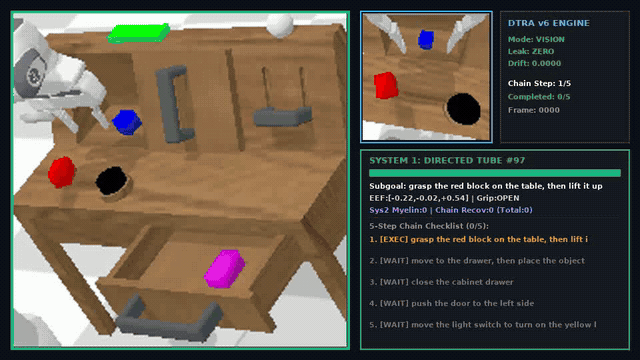
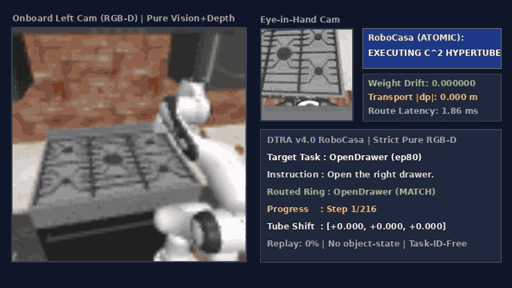
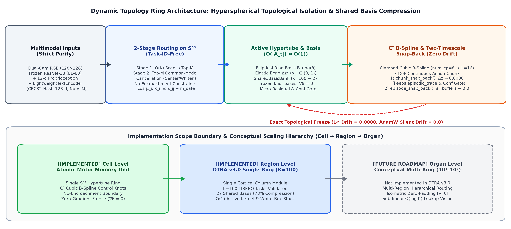
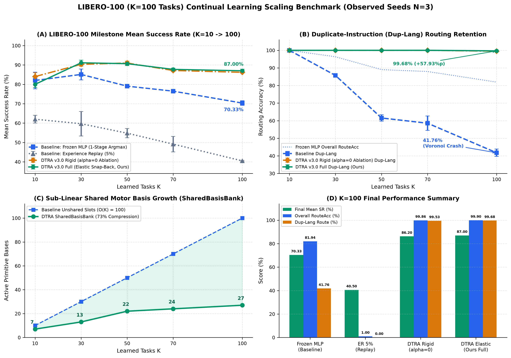

# DTRA: Dynamic Topology Ring Architecture for Replay-Free Continual Visuomotor Control via Hyperspherical Isolation and Shared Motor Bases

[English](README.md) | [한국어](README_KO.md)

[](paper_v2/DTRA_v3.0_Preprint.pdf)
[](paper_v2/dtra_preprint.pdf)
[](https://doi.org/10.5281/zenodo.24297711)
[](https://doi.org/10.5281/zenodo.24218482)
[](paper_v2/dtra_preprint.tex)
[](https://github.com/5Color/abk-vla)
[](https://doi.org/10.5281/zenodo.24212130)
[](../LICENSE)

> *"If a mind must erase yesterday to learn today, it is not intelligence—it is merely a calculator."* — Seungjoon Son

Research materials, 20-page preprint manuscripts, and continual-learning benchmarks for **DTRA** (*Dynamic Topology Ring Architecture*, corresponding to [`5Color/dtra`](https://github.com/5Color/dtra)), a geometry-first, replay-free, and Task-ID-free continual visuomotor control framework.

> **Repository & Scope Separation:**
> - **Published Preprint Core (`DTRA v3.0`):** Single-ring `Region` architecture (System 1) verified on 3-seed 3D Meta-World ($K=8$), LIBERO-Goal ($K=5$), and 3-seed 7-DoF LIBERO-100 ($K=100$).
> - **Post-v3 Embodied Extension Tracks (`v4.0`–`v6.0`):** Strictly separated from the `v3.0` preprint tables per [`PAPER_20P_OUTLINE.md`](PAPER_20P_OUTLINE.md) and archived under [`experiments/robocasa_v4/`](experiments/robocasa_v4/), [`experiments/calvin_v4/`](experiments/calvin_v4/), [`experiments/calvin_v5/`](experiments/calvin_v5/), and [`outputs/calvin_v6/`](outputs/calvin_v6/). Note that `v6.0`'s `OrganSystem2Planner` borrows the `Organ` name from the prior **ARIN** hierarchy as a lightweight System 2 routing prototype, distinct from the conceptual multi-ring $10^4\text{--}10^8$ `Organ` roadmap.
> - **Generation 1 Predecessors (`Drawing-VLA` & `ABK-VLA`):** Archived in [`../v1_drawing_vla/`](../v1_drawing_vla/) (`Drawing-VLA` v1.0.0 DOI: [`10.5281/zenodo.24122154`](https://doi.org/10.5281/zenodo.24122154); `ABK-VLA` v1.1.3 DOI: [`10.5281/zenodo.24212130`](https://doi.org/10.5281/zenodo.24212130), v1.1.1: `24208545`).

> **Inference-input scope:** Task-ID-free means no integer task index is passed to the policy at inference. Routing uses onboard camera features (plus depth in pure RGB-D tracks), proprioception, and a language embedding; evaluations that provide language commands are command-conditioned, not observation-only.

---

## Visual Rollout Demos

Lightweight `640x360` @ `12 fps` inline previews (`< 8 MB` each for direct GitHub README playback) from the post-v3 pure-vision embodied tracks:

| DTRA v6.0 — CALVIN Pure Vision 5-Step Chain (System 1 + System 2) | DTRA v4.0 — RoboCasa Pure RGB-D Kitchen Rollout (Hypertube Transport) |
| :---: | :---: |
|  |  |
| **Canonical `5/5` Sequence (`Chain #1`, `Mode: VISION`, `Leak: ZERO`, `Drift: 0.0000`):** `lift_red_block_table` $\rightarrow$ `place_in_drawer` $\rightarrow$ `close_drawer` $\rightarrow$ `move_slider_left` *(live System 2 recovery `CELL #108 -> #100`)* $\rightarrow$ `turn_on_lightbulb`. Across 34 tasks / 30 chains: **`97.65%` RouteAcc**, **`2.37` mean chain len** (vs `1.90`), **`16.67%` 5/5 SR** (vs `6.67%`), **`+15.12%` jerk reduction**, **`9.30 ms` latency**. ([Scope Notes](outputs/calvin_v6/BENCHMARK_SCOPE_AND_LIMITATIONS.md) \| Raw HUD MP4: `outputs/calvin_v6/dtra_v6_pure_vision_chain_hud.mp4`) | **12 Kitchen Tasks (`8` Atomic + `4` Composite, `0%` Replay, No `object-state`, `Drift: 0.000000`):** `Arm4_DTRA_v4_Hypertube` achieves **`29.17%` Atomic SR** (`OpenMicrowave 100.0%`, `CloseDrawer 66.67%`, `OpenDrawer 33.33%`, `PickPlaceCounterToSink 33.33%`), **`100.0%` RouteAcc**, **`+0.00%` BWT**, **`1.928 ms` latency**—while `Flat_MLP` and `ER_5%` collapse to `0.00%`. Composite `0.00%` exposes the System 1 bottleneck that motivated `v5.0`/`v6.0`. ([Results JSON](experiments/robocasa_v4/robocasa_continual_results_4arms.json) \| Raw HUD MP4: `experiments/robocasa_v4/robocasa_pure_rgbd_hud_rollout.mp4`) |

---

## 1. Research Lineage & Architecture Overview (`ARIN` $\rightarrow$ `DTRA v6.0`)

### A. Research Evolution (`v1` $\rightarrow$ `v6.0`)

Rather than scaling a single monolithic parameter matrix, DTRA builds sensorimotor memory bottom-up from bounded **Cells** (myelinated $\nabla_\theta = 0$ trajectory tubes) into **Regions** (single-ring cortical modules) and executive transition graphs:

| Stage | Version / Work | Key Mechanism & Hierarchy Role | Benchmark & Verified Milestone |
| :--- | :--- | :--- | :--- |
| **Stage 0** | **ARIN** *(DYN-39–65 empirical; DYN-66 spec)* | Bounded Cell experience sharing (`+34.18%p`) & independent audit protocol; isolated `Read Preservation` (`DYN-63: 99.57%`) vs. `Next WRITE` interference (`DYN-65`) | Established `Cell -> Coalition -> Region -> Organ` emergent taxonomy |
| **Stage 1** | **Drawing-VLA** *(v1.0.0 DOI: `24122154`)* | Closed-loop ACT (`K=16`, `q=6`, `w_up=10.0`) + Catmull-Rom brush rendering | `HandVsAI` (`324` human demos): `99.9/100` S-Tier, `1.000` F1, `+20px` recovery |
| **Stage 2** | **ABK-VLA** *(v1.1.1 `24208545` / v1.1.3 `24212130`)* | $C^2$ clamped cubic B-Spline compression ($N_k=6 \rightarrow H=16$) & pure cosine routing (`Select-then-Blend`) | 2D ($K=4$): **`99.98%` conf**, **`1.66%` FR** (`0.00%` Hard Argmax/Oracle), `85.59%` F1; 3D Meta-World ($K=4$): **`91.7%` SR**, **`0.00%` FR**, **`100.0%` RouteAcc** |
| **Stage 3** | **DTRA v3.0** *(`v3.0.0` Preprint Core)* | $\mathbb{S}^{63}$ hyperspherical isolation + No-Encroachment + Top-$M$ CMC + `SharedBasisBank` + Two-Timescale Snap-Back (**Single-Ring `Region`, System 1**) | LIBERO-100 ($K=100$, 3-seed): **`87.00 ± 0.86%` SR** (Seed 42 `87.80%`), **`99.90%` RouteAcc**, **`99.68%` Dup-Lang**, **`27` bases** (`73%` reduction), **`0.0` drift** |
| **Stage 4** | **DTRA v4.0** *(Kitchen Extension)* | Pure RGB-D stereo 3D `Hypertube Transport` & peak-margin gating | RoboCasa 12 tasks (`0%` replay): **`29.17%` Atomic SR**, **`100.0%` RouteAcc**; `0.00%` Composite diagnosed need for System 2 |
| **Stage 5** | **DTRA v5.0** *(CALVIN System 1 Backbone)* | 34-task System 1 backbone + `CalvinCameraVisionAnchorEstimatorV5` 3D $Z$-gating & myelinated transition graph extraction | Physically separates upper slider ($Z\in[0.52,0.65]\text{ m}$), tabletop blocks ($[0.43,0.50]\text{ m}$), and drawer ($[0.31,0.44]\text{ m}$) |
| **Stage 6** | **DTRA v6.0** *(CALVIN System 1+2)* | v5 System 1 + $C^2$ Geodesic Bridge (`Open String <-> Closed Ring`) + `OrganSystem2Planner` (noun-cluster/polarity filter + refractory backtracking) | CALVIN 34 tasks / 30 chains (Pure Vision): **`97.65%` RouteAcc**, **`2.37` mean chain len**, **`16.67%` 5/5 SR**, **`+15.12%` jerk reduction**, **`9.30 ms`**, **`0.0000` drift**, live **`5/5`** chain completion |

### B. Core Architecture (`v3.0` Single-Ring `Region` Core)



Scaling continual visuomotor control from $K=8$ Meta-World tasks to $K=100$ sequential 7-DoF LIBERO manipulation tasks (`libero_10 + libero_90`, including 30 tasks across 13 identical-instruction groups) exposes **Voronoi encroachment** and **$O(K)$ action-head parameter growth**. Under strict matched-encoder parity (`Frozen ResNet-18` DualCam + proprioception + `LightweightTextEncoder`), **DTRA v3.0** resolves both via four mechanisms:

1. **No-Encroachment Margin Refinement:** Caches prior task raw query anchors $\mu_j$ and self-similarity floors $s_{jj} = \cos(\mu_j, \mathbf{k}_j)$, projecting out repulsive key updates that would steal routing territory from prior Voronoi cells $0 \dots i-1$ on $\mathbb{S}^{63}$.
2. **Two-Stage Top-$M$ Common-Mode Cancellation (CMC):** Stage 1 retrieves Top-$M$ ($M=5$) candidates via $O(K)$ multimodal cosine scan; Stage 2 subtracts the candidate set's shared language/scene mean to isolate fine DualCam spatial grids ($4 \times 4 / 2 \times 2$ + DoG) and proprioceptive residuals, lifting $K=100$ `Dup-Lang` routing accuracy across 3 seeds from **41.76%** to **99.68 ± 0.45%** (Seed 42: `38.92%` $\rightarrow$ `99.05%`).
3. **SharedBasisBank + Zero AdamW Silent Drift:** Factorizes $H=16$ action chunks via clamped $C^2$ cubic B-Spline control points (`num_cp=8` for 7-DoF LIBERO-100 with `num_knots=6` internal basis width; `N_k=6` for 2D/Meta-World) into a dynamically shared library of frozen primitive bases, compressing $K=100$ tasks into **27 bases** (**73% basis-count reduction**) while enforcing `requires_grad=False` and optimizer exclusion ($L_\infty\text{ drift} = 0.0$).
4. **Two-Timescale Snap-Back:** Separates intra-episode chunk reset (`chunk_snap_back()`, $\Delta \mathbf{z}_i \leftarrow \mathbf{0}$) from episode-end refractory reset (`episode_snap_back()`, `post_snap_norm = 0.0000`) while retaining progress traces to prevent long-horizon perseveration.

---

## 2. Finalized Benchmark Results (`v3.0` Preprint Scope Only)

### A. LIBERO-100 ($K=10 \to 100$) Multi-Seed Continual Scaling (Seeds `42, 100, 2026`, Strict Encoder Parity)



All comparison arms share identical frozen perception and `LightweightTextEncoder`, streaming tasks with DTRA Elastic peak VRAM of `2,713 ± 77 MB` (`n_eval = 5` rollouts per milestone checkpoint; full 4-arm suite on Seeds `{42, 100}` [$N=2$] and 2-arm core parity [`arm_frozen_mlp`, `arm_dtra_elastic`] on Seeds `{42, 100, 2026}` [$N=3$]):

| Method (Strict Parity) | $K=10$ SR | $K=30$ SR | $K=50$ SR | $K=70$ SR | **$K=100$ SR $\uparrow$** | FR $\downarrow$ | BWT $\uparrow$ | RouteAcc $\uparrow$ | Dup-Lang $\uparrow$ | Bases | Active Latency |
| :--- | :---: | :---: | :---: | :---: | :---: | :---: | :---: | :---: | :---: | :---: | :---: |
| `arm_frozen_mlp` ($N=3$) | `82.00±4.32%` | `85.11±2.79%` | `79.07±0.50%` | `76.48±0.97%` | `70.33 ± 1.18%` | `2.90±1.05%` | `+0.20±2.29%` | `81.94±0.24%` | `41.76 ± 2.09%` | `100.0` | `6.46±0.57 ms` |
| `arm_er_5pct` ($N=2$) | `62.00±2.00%` | `59.67±6.33%` | `54.80±2.40%` | `49.14±4.00%` | `40.50 ± 0.30%` | `27.07±4.04%` | `-20.71±2.93%` | `1.00±0.00%` | `0.00 ± 0.00%` | `1.0` | `5.34±0.03 ms` |
| `arm_dtra_rigid` ($N=2$) | `84.00±2.00%` | `90.33±1.00%` | `91.00±1.00%` | `87.14±0.57%` | `86.20 ± 0.00%` | `2.93±0.91%` | `+0.10±0.91%` | `99.86±0.14%` | `99.53 ± 0.47%` | `27.0` | `9.36±0.05 ms` |
| **`arm_dtra_elastic` ($N=3$, Full)** | `80.00±1.63%` | **`91.11±1.37%`** | **`90.67±1.00%`** | **`87.71±0.70%`** | **`87.00 ± 0.86%`** | **`2.69±0.67%`** | **`+0.20±0.72%`** | **`99.90±0.13%`** | **`99.68 ± 0.45%`** | **`27.0`** | `9.55±0.20 ms` |

* **Per-Seed Final $K=100$ Breakdown:**
  * `arm_dtra_elastic`: Seed 42 **`87.80%`** (Dup-Lang `99.05%`, BWT `+0.61%`), Seed 100 **`87.40%`**, Seed 2026 **`85.80%`** $\rightarrow$ **3-Seed Mean `87.00 ± 0.86%`** (`+16.67%p` SR and `+57.93%p` Dup-Lang routing over matched `arm_frozen_mlp`; sub-linear `7 -> 13 -> 22 -> 24 -> 27` frozen shared bases across all seeds).
  * `arm_frozen_mlp`: Seed 42 `72.00%` (Dup-Lang `38.92%`, BWT `+3.43%`), Seed 100 `69.60%`, Seed 2026 `69.40%` $\rightarrow$ Mean `70.33 ± 1.18%`.
* **Note on Milestone FR/BWT Under Exact Parameter Freezing:** Weight parameters incur strictly **0.0** gradient drift ($\nabla_\theta = 0$). In `arm_frozen_mlp`, intra-interval Voronoi encroachment degrades accuracy between discrete checkpoints prior to peak capture, collapsing `Mean SR` (`70.33%`) rather than inflating milestone-delta `FR` (`2.90%`), while residual `~2%` FR/BWT reflects $n_{\text{eval}}=5$ binomial simulator variance.

### B. LIBERO-Goal 5-Task Pilot (Seed 42, $n_{\text{eval}}=5$)

| Method (4 Parity Arms) | Mean SR $\uparrow$ | FR $\downarrow$ | BWT $\uparrow$ | Route $\uparrow$ | Peak VRAM |
| :--- | :---: | :---: | :---: | :---: | :---: |
| Frozen Slot MLP (Baseline) | `100.0%` | `0.0%` | `+15.0%` | `100.0%` | `3695 MB` |
| Experience Replay (5%) | `88.0%` | `10.0%` | `-5.0%` | --- | `3298 MB` |
| DTRA Rigid ($\alpha=0$) | `88.0%` | `10.0%` | `-5.0%` | `100.0%` | `3696 MB` |
| **DTRA v3.0 Elastic (Ours)** | `92.0%` | `5.0%` | `+0.0%` | `100.0%` | `3696 MB` |

### C. 3D Meta-World 8-Task Continual Ablation (3-Seed Mean ± Std, Seeds `42, 100, 2026`)

| Method | Clean SR $\uparrow$ | FR $\downarrow$ | Clean Route $\uparrow$ | Severe OOD SR $\uparrow$ | OOD Route $\uparrow$ | CPU Active ($K=1\to 8$) |
| :--- | :---: | :---: | :---: | :---: | :---: | :---: |
| ABK-VLA v1.1.3 (DoG Vision) | `82.8 ± 2.6%` | `0.0 ± 0.0%` | `99.7%` | `2.2 ± 1.0%` | `34.7%` | `0.27 -> 0.83 ms` |
| Frozen Slot MLP (Multimodal) | `85.6 ± 3.1%` | `0.0 ± 0.0%` | `100.0%` | `23.6 ± 3.9%` | `100.0%` | `0.21 -> 0.20 ms` |
| **DTRA Full (Multimodal, Ours)** | `72.2 ± 6.8%` | **`0.0 ± 0.0%`** | **`100.0%`** | **`51.4 ± 4.4%`** | **`100.0%`** | **`1.87 -> 1.87 ms`** |

### Evaluation scope and resource interpretation

Frozen MLP and DTRA Elastic use seeds 42, 100, and 2026; ER 5% and DTRA Rigid use seeds 42 and 100. Each task is evaluated with five rollouts per seed using the same first five provided initial states. Cross-seed standard deviations are not confidence intervals over a broader initial-state distribution.

Parameter freezing and temporary state reset are separate: `post_snap_norm = 0.0000` records a reset state, not an independent before/after weight comparison. LIBERO-100 success-rate forgetting is **2.69 ± 0.67%**. Its sources have not been separated into routing changes and rollout variability.

The **73% reduction concerns motor basis count**, from one basis per task to 27 shared bases at K=100. Recorded policy parameters occupy **183.14 MB** for DTRA versus **151.67 MB** for Frozen MLP, excluding the common frozen backbone. The experiments do not establish an asymptotic memory-growth law or a break-even task count beyond K=100.

On Meta-World, DTRA Full has lower clean success (**72.2 ± 6.8%** vs. **85.6 ± 3.1%**) and higher severe OOD success (**51.4 ± 4.4%** vs. **23.6 ± 3.9%**) than multimodal Frozen MLP. This is an observed trade-off, not a demonstrated causal explanation. Registration involves training; the **9.55 ± 0.20 ms** LIBERO figure measures policy inference. Broad retrieval remains O(K), with a constant-cost selected decoding core.

---

## 3. Post-v3 Embodied Continual Tracks (`DTRA v4.0 – v6.0`, Separate from v3.0 Preprint)

### A. DTRA v4.0 — RoboCasa 12-Task Kitchen Continual Benchmark (Pure RGB-D, Unmodified `_check_success`)

Evaluated across 12 kitchen manipulation tasks (`8` Atomic + `4` Composite) with strict onboard RGB-D + proprioception + language (no simulator `object-state`, Task-ID-Free):

| Arm (`12` Tasks: `8` Atomic + `4` Composite) | Replay | Init SR | Final SR | Atomic SR | Composite SR | BWT | RouteAcc | Parameter Drift | Latency |
| :--- | :---: | :---: | :---: | :---: | :---: | :---: | :---: | :---: | :---: |
| `Arm1_Flat_MLP` | `0%` | `5.56%` | `0.00%` | `0.00%` | `0.00%` | `-5.56%` | `N/A` | `38.432926` | `0.694 ms` |
| `Arm2_ER_5pct` | `5%` | `5.56%` | `0.00%` | `0.00%` | `0.00%` | `-5.56%` | `N/A` | `38.927582` | `0.633 ms` |
| `Arm3_DTRA_v4_NoTransport` | `0%` | `16.67%` | `16.67%` | `25.00%` | `0.00%` | `+0.00%` | `100.0%` | `0.000000` | `1.380 ms` |
| **`Arm4_DTRA_v4_Hypertube`** | **`0%`** | **`19.44%`** | **`19.44%`** | **`29.17%`** | `0.00%` | **`+0.00%`** | **`100.0%`** | **`0.000000`** | **`1.928 ms`** |

* **Diagnosis:** Stereo 3D `Hypertube Transport` (`Arm4`) reaches `OpenMicrowave 100.00%`, `CloseDrawer 66.67%`, `OpenDrawer 33.33%`, and `PickPlaceCounterToSink 33.33%` with zero catastrophic forgetting (`BWT +0.00%`, `Drift 0.000000`). However, multi-stage Composite tasks (`OrganizeVegetables`, etc.) score `0.00%` under a pure System 1 trajectory generator, directly motivating the `v5.0`/`v6.0` System 1+2 transition architecture.

### B. DTRA v5.0 & v6.0 — CALVIN 34-Task & Long-Horizon 5-Step Chain Evaluation (`System 1 + System 2`)

* **v5.0 System 1 Backbone + 3D $Z$-Gating (`CalvinCameraVisionAnchorEstimatorV5`):** Physically isolates RGB-D back-projected targets into upper cabinet `door`/`slider` ($Z \in [0.52, 0.65]\text{ m}$), tabletop `block_*` ($Z \in [0.43, 0.50]\text{ m}$), and lower `drawer` ($Z \in [0.31, 0.44]\text{ m}$) workspaces, eliminating cross-plane anchor misassociation (e.g., upper slider vs. tabletop pink block) while extracting myelinated skill transition graphs across 34 tasks (`340` topological cells).
* **v6.0 System 1+2 Integration (`C^2 Geodesic Bridge` + `OrganSystem2Planner`):** Connects sequential open-string trajectories into dynamically closed circuits via $\mathbb{S}^{63}$ SLERP + $C^2$-continuous geodesic bridging, while `OrganSystem2Planner` enforces object-noun cluster (`door_slider`, `drawer`, `block`, `light`, etc.) and action-polarity filtering during 2-attempt refractory backtracking (`30` precondition-valid 5-step chains):

| Mode (`CALVIN 34` Tasks, `30` Chains) | RouteAcc $\uparrow$ | Single-Task Mean SR | 5-Chain Mean Len $\uparrow$ *(vs Hard-Switch)* | 5-Chain Full 5/5 SR $\uparrow$ *(vs Hard-Switch)* | Boundary Jerk Reduction | Myelinated Edges | Latency | Drift |
| :--- | :---: | :---: | :---: | :---: | :---: | :---: | :---: | :---: |
| **`Pure Vision` (`Leak: ZERO`)** | **`97.65%`** | `55.88%` | **`2.37`** *(vs `1.90`)* | **`16.67%`** *(vs `6.67%`)* | **`+15.12%`** (`0.0752` vs `0.0886`) | `22` | `9.30 ms` | **`0.0000`** |
| `Oracle Anchor` *(Upper-Bound Ref)* | `97.65%` | `46.47%` | `2.53` *(vs `1.90`)* | `16.67%` *(vs `10.00%`)* | `+15.24%` (`0.0684` vs `0.0807`) | `25` | `8.49 ms` | `0.0000` |

* See [`outputs/calvin_v6/BENCHMARK_SCOPE_AND_LIMITATIONS.md`](outputs/calvin_v6/BENCHMARK_SCOPE_AND_LIMITATIONS.md) for full experimental scope, precondition-chain rules, and limitations (`16.67%` full 5/5 chain SR vs canonical `Chain #1` HUD showcase).

---

## 4. Repository Structure (`dtra/`)

```text
dtra/
├── assets/                              # Lightweight README preview GIFs (< 8 MB, 640x360 @ 12 fps)
├── PAPER_20P_OUTLINE.md                 # Exact 20-page NeurIPS/CoRL outline & v3.0/v4.0 boundary ledger
├── core/
│   ├── bspline_core.py                  # C^2 clamped cubic B-Spline trajectory decoder (N_k=6 [2D/Meta-World] or num_cp=8 [7-DoF LIBERO] -> H=16)
│   ├── hypertube_transport.py           # [v4.0+ Track] Object-centric hypertube coordinate transport
│   ├── sim_dtra_tube_dynamics.py        # Hypertube ring dynamics, elastic attraction & snap-back kernel
│   └── topological_bridge.py            # C^2 geodesic bridge & myelinated transition graph core
├── experiments/
│   ├── libero/
│   │   └── benchmark_dtra_libero.py     # LIBERO-Goal & LIBERO-100 continual suite runner & SharedBasisBank
│   ├── metaworld/
│   │   ├── ablate_dtra_scientific.py    # 3-seed 6-arm 3D Meta-World ablation & CPU O(1) benchmark
│   │   ├── ablate_dtra_supplemental.py  # Naive FT / EWC / ER5% / multi-OOD / reverse-order checks
│   │   └── benchmark_dtra_3d_metaworld.py
│   ├── calvin_v4/, calvin_v5/           # [Post-v3 Track] CALVIN 34-task System 1 & Z-gating anchors
│   └── robocasa_v4/                     # [Post-v3 Track] RoboCasa 12-task pure RGB-D kitchen benchmark
├── outputs/
│   └── calvin_v6/                       # [Post-v3 Track] CALVIN v6 System 1+2 JSONs, HUD & scope notes
├── visualization/
│   └── visualize_dtra_xai.py            # White-box routing & hypertube XAI diagnostics
└── paper_v2/
    ├── DTRA_v3.0_Preprint.pdf           # GitHub/personal build (DTRA v3.0, 20 pages, >=8.5pt tables)
    ├── dtra_preprint.pdf                # Clean arXiv build (pure ASCII TeX + pdfLaTeX safe, 20 pages)
    ├── dtra_v3.0_preprint.tex           # XeTeX 20-page LaTeX source
    ├── dtra_preprint.tex                # Pure ASCII arXiv 20-page LaTeX source
    └── DTRA_v2_Spec.md                  # Technical specification archive
```

---

## 5. Quickstart (Run from Repository Root)

Core modules, unit tests, figure/paper generation scripts, locked JSON results, and the Meta-World / LIBERO / post-v3 benchmark scripts are included in the repository. Installing `requirements.txt` supports the unit tests, core invariant checks, and figure/PDF rebuilds; running live simulator benchmarks requires installing the external simulator packages (`metaworld`/`mujoco`/`gymnasium`, or `libero`/`robosuite`/`bddl`/`h5py` plus LIBERO HDF5 demos) separately. Run `python scripts/check_remote_env.py` to verify your local environment.

```bash
# Environment Check & Unit Tests (No-Encroachment, CMC, Snap-Back, SharedBasisBank, Bridge)
pip install -r requirements.txt
python scripts/check_remote_env.py --env dtra
python -m unittest discover -s tests -v
python dtra/tests/test_topological_bridge.py
python dtra/core/sim_dtra_tube_dynamics.py

# LIBERO-100 (K=100) Continual Benchmark (requires `libero` conda env + LIBERO HDF5 demos)
python -m dtra.experiments.libero.benchmark_dtra_libero \
  --suites libero_10,libero_90 --max-tasks 100 \
  --stream-tasks --eval-milestones 10,30,50,70,100 \
  --epochs 25 --batch-size 128 --n-eval 5 --seed 42 \
  --out-json outputs/libero/benchmark_dtra_libero_10_libero_90_k100.json

# 3D Meta-World 3-Seed Scientific Ablation (requires metaworld/mujoco)
python -m dtra.experiments.metaworld.ablate_dtra_scientific --seeds 42 100 2026 --epochs 80

# Rebuild 3-Seed Tables, Figures & 20-Page Manuscripts
python scripts/summarize_libero_multiseed.py
python scripts/generate_libero100_figures.py
python scripts/build_dtra_v3_paper.py
```

---

## 6. Citation

```bibtex
@misc{son2026dtra,
  author       = {Son, Seungjoon},
  title        = {{DTRA}: Dynamic Topology Ring Architecture for Replay-Free Continual Visuomotor Control via Hyperspherical Isolation and Shared Motor Bases},
  year         = {2026},
  month        = nov,
  publisher    = {Zenodo},
  doi          = {10.5281/zenodo.24297711},
  url          = {https://doi.org/10.5281/zenodo.24297711},
  note         = {v3.0.0; Concept DOI: 10.5281/zenodo.24218482; prior v2.1.0: 10.5281/zenodo.24218483}
}

@misc{son2026abkvla,
  author       = {Son, Seungjoon},
  title        = {{ABK-VLA}: Task-ID-Free Continual Visuomotor Policy Learning via Autonomous B-Spline Knot Compression and Visual Prototype Routing},
  year         = {2026},
  month        = nov,
  publisher    = {Zenodo},
  doi          = {10.5281/zenodo.24212130},
  url          = {https://doi.org/10.5281/zenodo.24212130},
  note         = {v1.1.3; v1.1.1: 10.5281/zenodo.24208545; Concept DOI: 10.5281/zenodo.24208544}
}
```
