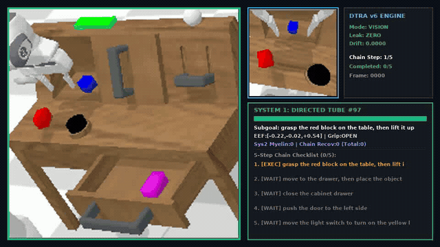
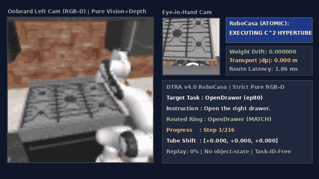
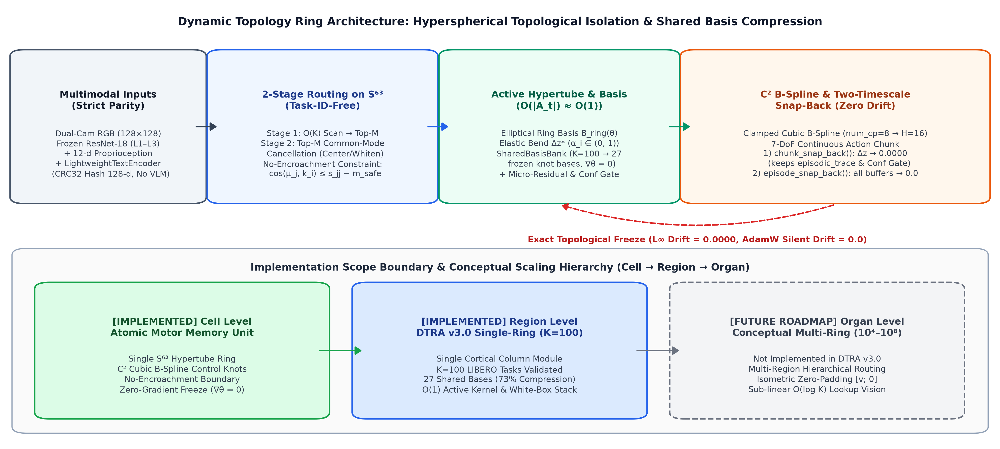
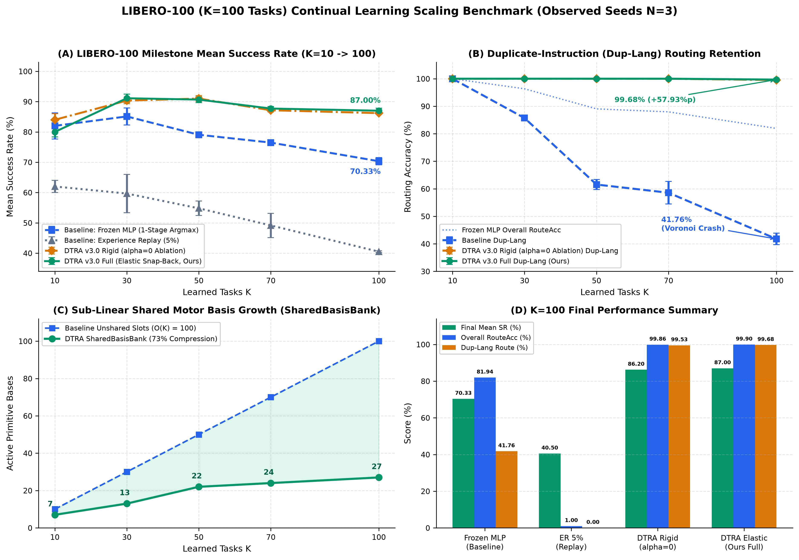

# DTRA: 기하학적 분리와 공유 운동 기저를 이용한 재생 없는 지속 시각운동 제어

[English](README.md) | **한국어**

[](paper_v2/DTRA_v3.0_Preprint.pdf)
[](paper_v2/dtra_preprint.pdf)
[](https://doi.org/10.5281/zenodo.24297711)
[](https://doi.org/10.5281/zenodo.24218482)
[](paper_v2/dtra_preprint.tex)
[](https://github.com/5Color/abk-vla)
[](https://doi.org/10.5281/zenodo.24212130)
[](../LICENSE)

> *"어제의 기억을 지워야만 오늘을 배울 수 있다면, 그것은 지능이 아니라 단순한 계산기다."* — 손승준 (Seungjoon Son)

이 문서는 초구면 위상 격리와 공유 운동 기저를 기반으로 재생 버퍼와 테스트 시 Task-ID 없이 순차 시각운동 제어를 수행하는 **DTRA**(*Dynamic Topology Ring Architecture*, [`5Color/dtra`](https://github.com/5Color/dtra))의 연구 자료와 실증 결과를 안내합니다.

> **버전과 실험 범위 분리:**
> - **공식 프리프린트 본편 (`DTRA v3.0`):** 단일 링 `Region` 아키텍처(System 1)로서 3개 시드 3D Meta-World($K=8$), LIBERO-Goal($K=5$), 3개 시드 7-DoF LIBERO-100($K=100$) 범위입니다.
> - **v3 이후 체화 연속학습 확장 트랙 (`v4.0`–`v6.0`):** [`PAPER_20P_OUTLINE.md`](PAPER_20P_OUTLINE.md)에 따라 `v3.0` 프리프린트 실측 표와는 엄격히 분리되어 [`experiments/robocasa_v4/`](experiments/robocasa_v4/), [`experiments/calvin_v4/`](experiments/calvin_v4/), [`experiments/calvin_v5/`](experiments/calvin_v5/), [`outputs/calvin_v6/`](outputs/calvin_v6/)에 아카이빙되어 있습니다. `v6.0`의 `OrganSystem2Planner`는 선행 **ARIN** 계보의 `Organ` 명칭을 차용한 경량 System 2 라우팅 프로토타입이며, 개념적 다중 링 `Organ`($10^4\text{--}10^8$) 로드맵과는 구분됩니다.
> - **1세대 선행 연구 (`Drawing-VLA` & `ABK-VLA`):** [`../v1_drawing_vla/`](../v1_drawing_vla/)에 보관되어 있습니다 (`Drawing-VLA` v1.0.0 DOI: [`10.5281/zenodo.24122154`](https://doi.org/10.5281/zenodo.24122154), `ABK-VLA` v1.1.3 DOI: [`10.5281/zenodo.24212130`](https://doi.org/10.5281/zenodo.24212130) / v1.1.1: `24208545`).

> **입력 프로토콜:** 정책 라우팅은 카메라 영상(순수 RGB-D 트랙은 깊이 포함), 고유수용성 상태와 언어 임베딩을 입력으로 받습니다. **Task-ID-free**는 추론 함수에 정수형 태스크 인덱스를 직접 전달하지 않는다는 의미이며, 언어 지시가 제공되는 설정은 순수 관측 전용 평가와 구별됩니다.

---

## Visual Rollout Demos

GitHub README에서 바로 재생되도록 `640×360` @ `12 fps`, `8 MB` 이하로 경량화한 순수 비전/RGB-D 롤아웃 프리뷰입니다.

| DTRA v6.0 — CALVIN 순수 비전 5-Step 체인 (System 1 + System 2) | DTRA v4.0 — RoboCasa 순수 RGB-D 주방 조작 (Hypertube Transport) |
| :---: | :---: |
|  |  |
| **표준 5/5 연속 시퀀스 (`Chain #1`, `Mode: VISION`, `Leak: ZERO`, `Drift: 0.0000`):** `lift_red_block_table` $\rightarrow$ `place_in_drawer` $\rightarrow$ `close_drawer` $\rightarrow$ `move_slider_left` *(실시간 System 2 복구 `CELL #108 -> #100`)* $\rightarrow$ `turn_on_lightbulb`. 34태스크·30체인 전체: **라우팅 `97.65%`**, **평균 체인 길이 `2.37`** (기준 `1.90`), **5/5 완주율 `16.67%`** (기준 `6.67%`), **저크 감소 `+15.12%`**, **지연 `9.30 ms`**. ([범위/한계 문서](outputs/calvin_v6/BENCHMARK_SCOPE_AND_LIMITATIONS.md) \| 원본 HUD MP4: `outputs/calvin_v6/dtra_v6_pure_vision_chain_hud.mp4`) | **주방 12태스크 (`8` 단일 + `4` 복합, `0%` 리플레이, `object-state` 미사용, `Drift: 0.000000`):** `Arm4_DTRA_v4_Hypertube`가 **단일(Atomic) SR `29.17%`** (`OpenMicrowave 100.0%`, `CloseDrawer 66.67%`, `OpenDrawer 33.33%`, `PickPlaceCounterToSink 33.33%`), **라우팅 `100.0%`**, **BWT `+0.00%`**, **지연 `1.928 ms`** 달성(`Flat_MLP`와 `ER_5%`는 `0.00%`로 붕괴). 복합 태스크 `0.00%` 병목이 `v5.0`/`v6.0` System 2 도입의 근거가 되었습니다. ([결과 JSON](experiments/robocasa_v4/robocasa_continual_results_4arms.json) \| 원본 HUD MP4: `experiments/robocasa_v4/robocasa_pure_rgbd_hud_rollout.mp4`) |

---

## 1. 연구 계보 및 아키텍처 개요 (`ARIN` $\rightarrow$ `DTRA v6.0`)

### A. 연구 진화 계보 (`v1` $\rightarrow$ `v6.0`)

DTRA는 단일 거대 행렬을 키우는 대신, 유계 기억 단위인 **Cell**(수초화 $\nabla_\theta = 0$ 궤적 튜브)에서 **Region**(단일 링 피질 모듈) 및 전이 그래프로 상향식 조직화합니다.

| 단계 | 프로젝트 / 버전 | 핵심 기법 및 계층적 위치 | 검증 환경 및 확정 성과 |
| :--- | :--- | :--- | :--- |
| **0단계** | **ARIN** *(DYN-39~65 실증 · DYN-66 사전 명세)* | 제한된 Cell 간 경험 공유(`+34.18%p`) 및 독립 감사 규약; 읽기 보존(`DYN-63: 99.57%`) vs 후속 쓰기 간섭(`DYN-65`) 경계 규명 | `Cell -> Coalition -> Region -> Organ` 계층 분화 기준 정립 |
| **1단계** | **Drawing-VLA** *(v1.0.0 DOI: `24122154`)* | 태블릿 펜 드로잉에서 착안한 ACT(`K=16`, `q=6`, `w_up=10.0`) + Catmull-Rom 브러시 기반 폐루프 제어 | `HandVsAI` 인간 시연 `324`건: `99.9/100` S-Tier, F1 `1.000`, `+20px` 복구 검증 |
| **2단계** | **ABK-VLA** *(v1.1.1 `24208545` / v1.1.3 `24212130`)* | $C^2$ 클램프드 3차 B-스플라인 압축($N_k=6 \rightarrow H=16$) 및 순수 코사인 라우팅(`Select-then-Blend`) | 2D($K=4$): **대각 신뢰도 `99.98%`**, **망각률 `1.66%`**(Hard Argmax·Oracle `0.00%`), F1 `85.59%` / 3D Meta-World($K=4$): **평균 SR `91.7%`**, **FR `0.00%`**, **라우팅 `100.0%`** |
| **3단계** | **DTRA v3.0** *(`v3.0.0` 프리프린트 본편)* | $\mathbb{S}^{63}$ 위상 격리 + No-Encroachment + Top-$M$ CMC + `SharedBasisBank` + Elastic Snap-Back (**단일 `Region`, System 1**) | LIBERO-100 ($K=100$, 3시드): **평균 SR `87.00 ± 0.86%`** (Seed 42 `87.80%`), **라우팅 `99.90%`**, **Dup-Lang `99.68%`**, **기저 `27`개(`73%` 압축)**, **드리프트 `0.0`** |
| **4단계** | **DTRA v4.0** *(주방 조작 확장)* | 순수 RGB-D 스테레오 3D `Hypertube Transport` 및 피크 마진 게이팅 | RoboCasa 12태스크(`0%` 리플레이): **단일 SR `29.17%`**, **라우팅 `100.0%`**; 복합 `0.00%`로 System 2 필요성 입증 |
| **5단계** | **DTRA v5.0** *(CALVIN System 1 백본)* | 34태스크 System 1 백본 + `CalvinCameraVisionAnchorEstimatorV5` 3D $Z$-게이팅 및 수초화 전이 그래프 추출 | 상단 미닫이문($Z\in[0.52,0.65]\text{ m}$), 테이블 블록($[0.43,0.50]\text{ m}$), 서랍($[0.31,0.44]\text{ m}$) 물리 분리 |
| **6단계** | **DTRA v6.0** *(CALVIN System 1+2)* | v5 System 1 + $C^2$ 측지선 브리지(`Open String <-> Closed Ring`) + `OrganSystem2Planner` (목적어 클러스터·극성 필터 + 불응기 백트래킹) | CALVIN 34태스크·30체인(순수 비전): **라우팅 `97.65%`**, **평균 체인 `2.37`**, **5/5 완주 `16.67%`**, **저크 감소 `+15.12%`**, **`9.30 ms`**, **드리프트 `0.0000`**, **`5/5` 실증 완료** |

### B. 핵심 아키텍처 (`v3.0` 단일 링 `Region` 본편)



Meta-World 8태스크에서 LIBERO의 순차 100태스크로 확장하면 라우팅 영역의 침범(Voronoi encroachment)과 태스크별 행동 헤드의 선형 증가가 문제가 됩니다. v3.0은 동결된 ResNet-18 DualCam 인코더, 고유수용성 입력, `LightweightTextEncoder`를 공통 인식 경로로 사용하고 다음 네 요소를 결합합니다.

1. **라우팅 마진 보정(No-Encroachment Margin Refinement):** 이전 태스크의 원시 쿼리 기준점과 자기 유사도 하한을 보존하고, 이전 라우팅 영역을 침범하는 키 업데이트를 투영해 제거합니다.
2. **2단계 Top-M 공통 성분 제거(CMC):** 1단계에서 전체 키에 대한 멀티모달 코사인 스캔으로 후보 5개를 찾고, 2단계에서 후보들이 공유하는 언어·장면 성분을 빼 세부 카메라 특징과 고유수용성 잔차로 재순위화합니다. LIBERO-100에서 동일 지시어 태스크(`Dup-Lang`) 라우팅 정확도는 3개 시드 평균 `41.76%`에서 `99.68 ± 0.45%`로(Seed 42 기준 `38.92%` $\rightarrow$ `99.05%`) 보고되었습니다.
3. **공유 운동 기저(SharedBasisBank):** 길이 16의 행동 청크를 클램프드 `C²` 큐빅 B-스플라인 제어점(7-DoF LIBERO-100은 `num_cp=8` 제어점·내부 매듭 잠재 차원 `num_knots=6`; 2D/Meta-World는 `N_k=6` 제어점)으로 나타내고, 태스크별 표현을 동결된 공유 원시동작 기저로 분해합니다. 100개 태스크에서 27개 기저를 사용했습니다. 이는 기저 개수 기준 73% 감소이며, 전체 모델 메모리가 감소했다는 뜻은 아닙니다.
4. **두 시간척도의 Snap-Back:** 청크 사이의 임시 변형 상태를 되돌리는 `chunk_snap_back()`과 에피소드 종료 시의 `episode_snap_back()`을 구분합니다. `post_snap_norm = 0.0000`은 해당 상태가 초기화되었음을 뜻하며, 학습 파라미터가 보존되었다는 독립적인 전후 비교 수치는 아닙니다.

---

## 2. 최종 벤치마크 결과 (`v3.0` 프리프린트 범위)

### A. LIBERO-100 순차 확장 ($K=10 \to 100$, Seeds `42, 100, 2026`)



태스크 10개에서 100개까지 순차 학습했습니다. 비교군은 동일한 동결 인식 경로와 `LightweightTextEncoder`를 사용합니다. 각 마일스톤에서 시드당 5회 롤아웃을 평가했습니다. 전체 4개 방법 비교는 2개 시드(`42, 100`)이며, `Frozen MLP`와 `DTRA Elastic` 핵심 비교는 3개 시드(`42, 100, 2026`)입니다.

| 방법 | 최종 성공률 ($K=100$) | 망각률 | BWT | 라우팅 정확도 | 동일 지시어 라우팅 | 기저 수 | 활성 추론 지연 |
| :--- | ---: | ---: | ---: | ---: | ---: | ---: | ---: |
| `arm_frozen_mlp` ($N=3$) | `70.33 ± 1.18%` | `2.90 ± 1.05%` | `+0.20 ± 2.29%` | `81.94 ± 0.24%` | `41.76 ± 2.09%` | `100` | `6.46 ± 0.57 ms` |
| `arm_er_5pct` ($N=2$) | `40.50 ± 0.30%` | `27.07 ± 4.04%` | `−20.71 ± 2.93%` | `1.00 ± 0.00%` | `0.00 ± 0.00%` | `1` | `5.34 ± 0.03 ms` |
| `arm_dtra_rigid` ($N=2$) | `86.20 ± 0.00%` | `2.93 ± 0.91%` | `+0.10 ± 0.91%` | `99.86 ± 0.14%` | `99.53 ± 0.47%` | `27` | `9.36 ± 0.05 ms` |
| **`arm_dtra_elastic` ($N=3$)** | **`87.00 ± 0.86%`** | **`2.69 ± 0.67%`** | **`+0.20 ± 0.72%`** | **`99.90 ± 0.13%`** | **`99.68 ± 0.45%`** | **`27`** | `9.55 ± 0.20 ms` |

* `arm_dtra_elastic`의 최종 시드별 성공률은 **Seed 42 `87.80%`**(`Dup-Lang 99.05%`, `BWT +0.61%`), **Seed 100 `87.40%`**, **Seed 2026 `85.80%`**이며 3-시드 평균은 **`87.00 ± 0.86%`**입니다(`arm_frozen_mlp` Seed 42는 `72.00%`, `Dup-Lang 38.92%`, `BWT +3.43%`). 시드 간 표준편차는 더 넓은 초기 상태 분포에 대한 신뢰구간이 아닙니다.

### B. LIBERO-Goal 5태스크 파일럿 (시드 42, 태스크별 평가 5회)

| 방법 | 평균 성공률 | 망각률 | BWT | 라우팅 정확도 | 최대 VRAM |
| :--- | ---: | ---: | ---: | ---: | ---: |
| Frozen Slot MLP (기준선) | `100.0%` | `0.0%` | `+15.0%` | `100.0%` | `3695 MB` |
| Experience Replay (5%) | `88.0%` | `10.0%` | `−5.0%` | — | `3298 MB` |
| DTRA Rigid (`α=0`) | `88.0%` | `10.0%` | `−5.0%` | `100.0%` | `3696 MB` |
| **DTRA v3.0 Elastic** | **`92.0%`** | `5.0%` | `0.0%` | **`100.0%`** | `3696 MB` |

### C. 3D Meta-World 8태스크 절제 실험 (3개 시드 평균 ± 표준편차)

| 방법 | 정상 조건 성공률 | 망각률 | 정상 라우팅 | 심한 OOD 성공률 | OOD 라우팅 | CPU 활성 추론 ($K=1\to 8$) |
| :--- | ---: | ---: | ---: | ---: | ---: | :--- |
| ABK-VLA v1.1.3 (DoG Vision) | `82.8 ± 2.6%` | `0.0 ± 0.0%` | `99.7%` | `2.2 ± 1.0%` | `34.7%` | `0.27 → 0.83 ms` |
| Frozen Slot MLP (멀티모달) | `85.6 ± 3.1%` | `0.0 ± 0.0%` | `100.0%` | `23.6 ± 3.9%` | `100.0%` | `0.21 → 0.20 ms` |
| **DTRA Full (멀티모달)** | `72.2 ± 6.8%` | **`0.0 ± 0.0%`** | **`100.0%`** | **`51.4 ± 4.4%`** | **`100.0%`** | **`1.87 → 1.87 ms`** |

### 평가 범위와 자원 수치 해석

- Frozen MLP와 DTRA Elastic은 시드 `42, 100, 2026`을 사용했습니다. ER 5%와 DTRA Rigid는 시드 `42, 100`을 사용했습니다. 각 태스크에서 시드당 동일한 첫 5개 초기 상태로 5회 평가했습니다.
- 파라미터 동결과 임시 상태 초기화는 서로 다른 항목입니다. `post_snap_norm = 0.0000`은 상태 초기화를 기록하며, 파라미터의 전후 독립 비교를 대신하지 않습니다. LIBERO-100 성공률 기준 망각률은 `2.69 ± 0.67%`입니다. 이 수치에서 라우팅 변화와 롤아웃 변동의 기여는 분리되지 않았습니다.
- `27`개 기저라는 수치는 태스크당 하나씩 두는 방식과 비교한 **기저 개수** 감소입니다. 공통 동결 백본을 제외한 정책 파라미터 저장 공간은 DTRA `183.14 MB`, Frozen MLP `151.67 MB`였습니다. $K=100$을 넘어서는 점근적 메모리 증가율이나 손익분기 태스크 수는 입증하지 않았습니다.
- Meta-World에서 DTRA Full은 멀티모달 Frozen MLP보다 정상 조건 성공률이 낮고(`72.2%` 대 `85.6%`), 심한 OOD에서 성공률이 높았습니다(`51.4%` 대 `23.6%`). 이는 관측된 성능 절충이며 인과적 설명이 입증된 것은 아닙니다.
- LIBERO의 `9.55 ± 0.20 ms`는 정책 추론 측정입니다. 넓은 후보 검색은 여전히 $O(K)$이며, 선택된 후보의 디코딩 코어가 상수 비용입니다. 따라서 이를 전체 로봇 제어 루프의 종단 간 지연이나 $O(1)$ 전체 라우팅으로 해석하면 안 됩니다.

---

## 3. 후속 체화 연속학습 확장 트랙 (`DTRA v4.0 – v6.0`, v3.0 본편과 분리)

### A. DTRA v4.0 — RoboCasa 12태스크 주방 연속학습 (순수 RGB-D, `_check_success` 무수정)

| 실험군 (`12` Tasks: `8` 단일 + `4` 복합) | 리플레이 | 초기 SR | 최종 SR | 단일(Atomic) SR | 복합(Composite) SR | BWT | RouteAcc | Parameter Drift | 지연 |
| :--- | :---: | :---: | :---: | :---: | :---: | :---: | :---: | :---: | :---: |
| `Arm1_Flat_MLP` | `0%` | `5.56%` | `0.00%` | `0.00%` | `0.00%` | `-5.56%` | `N/A` | `38.432926` | `0.694 ms` |
| `Arm2_ER_5pct` | `5%` | `5.56%` | `0.00%` | `0.00%` | `0.00%` | `-5.56%` | `N/A` | `38.927582` | `0.633 ms` |
| `Arm3_DTRA_v4_NoTransport` | `0%` | `16.67%` | `16.67%` | `25.00%` | `0.00%` | `+0.00%` | `100.0%` | `0.000000` | `1.380 ms` |
| **`Arm4_DTRA_v4_Hypertube`** | **`0%`** | **`19.44%`** | **`19.44%`** | **`29.17%`** | `0.00%` | **`+0.00%`** | **`100.0%`** | **`0.000000`** | **`1.928 ms`** |

* **진단:** 양안 스테레오 `Hypertube Transport`(`Arm4`)는 `OpenMicrowave 100.00%`, `CloseDrawer 66.67%`, `OpenDrawer 33.33%`, `PickPlaceCounterToSink 33.33%`를 망각 없이(`BWT +0.00%`, `Drift 0.000000`) 달성했습니다. 반면 다단계 복합 태스크(`OrganizeVegetables` 등)는 순수 System 1 궤적 생성기만으로 `0.00%`에 머물러, `v5.0`/`v6.0`의 System 2 전이 계층 도입 근거를 입증했습니다.

### B. DTRA v5.0 & v6.0 — CALVIN 34태스크 및 장기 5-Step 체인 실증 (`System 1 + System 2`)

* **v5.0 System 1 백본 + 3D $Z$-게이팅 (`CalvinCameraVisionAnchorEstimatorV5`):** 상단 캐비닛 미닫이문($Z\in[0.52,0.65]\text{ m}$), 테이블 블록($Z\in[0.43,0.50]\text{ m}$), 하단 서랍($Z\in[0.31,0.44]\text{ m}$)의 역투영 탐색 높이를 물리적으로 분리해 앵커 오매칭을 제거하고, 34태스크(`340` 셀)의 수초화 전이 그래프를 구축했습니다.
* **v6.0 System 1+2 통합 ($C^2$ 측지선 브리지 + `OrganSystem2Planner`):** $\mathbb{S}^{63}$ SLERP 및 $C^2$ 측지선 브리지로 개방끈 궤적을 동적 폐쇄 링으로 연결하고, 목적어 명사 클러스터·극성 필터 하에서 2회 불응기 백트래킹을 수행합니다(선행조건 충족 30개 5-Step 체인 기준).

| 평가 모드 (`CALVIN 34` Tasks, `30` Chains) | 라우팅 정확도 | 단일 태스크 SR | 5-Chain 평균 길이 *(vs Hard-Switch)* | 5-Chain 5/5 완주율 *(vs Hard-Switch)* | 경계 저크 감소율 | 활성 수초화 간선 | 폐루프 지연 | 파라미터 드리프트 |
| :--- | :---: | :---: | :---: | :---: | :---: | :---: | :---: | :---: |
| **`Pure Vision` (`Leak: ZERO`)** | **`97.65%`** | `55.88%` | **`2.37`** *(vs `1.90`)* | **`16.67%`** *(vs `6.67%`)* | **`+15.12%`** (`0.0752` vs `0.0886`) | `22` | `9.30 ms` | **`0.0000`** |
| `Oracle Anchor` *(상한 비교군)* | `97.65%` | `46.47%` | `2.53` *(vs `1.90`)* | `16.67%` *(vs `10.00%`)* | `+15.24%` (`0.0684` vs `0.0807`) | `25` | `8.49 ms` | `0.0000` |

* 전체 실험 범위·선행조건 규칙 및 한계(순수 비전 전체 5/5 완주율 `16.67%` vs 대표 `Chain #1` HUD 시연)는 [`outputs/calvin_v6/BENCHMARK_SCOPE_AND_LIMITATIONS.md`](outputs/calvin_v6/BENCHMARK_SCOPE_AND_LIMITATIONS.md)를 참고하세요.

---

## 4. 저장소 구조 (`dtra/`)

```text
dtra/
├── assets/                          # README용 경량 프리뷰 GIF (< 8 MB, 640x360 @ 12 fps)
├── PAPER_20P_OUTLINE.md             # 20쪽 프리프린트 구성 및 v3.0/v4.0+ 경계
├── core/
│   ├── bspline_core.py              # C² 클램프드 큐빅 B-스플라인 디코더 (N_k=6 [2D/Meta-World] 또는 num_cp=8 [7-DoF LIBERO] -> H=16)
│   ├── hypertube_transport.py       # [v4.0+ 트랙] 객체 중심 하이퍼튜브 좌표 트랜스포트
│   ├── sim_dtra_tube_dynamics.py    # 링 동역학과 탄성 복원 커널
│   └── topological_bridge.py        # C² 측지선 브리지 및 수초화 전이 그래프 코어
├── experiments/
│   ├── libero/                      # LIBERO-Goal 및 LIBERO-100
│   ├── metaworld/                   # Meta-World 평가와 절제 실험
│   ├── calvin_v4/, calvin_v5/       # [v3 이후 트랙] CALVIN 34태스크 System 1 & Z-게이팅
│   └── robocasa_v4/                 # [v3 이후 트랙] RoboCasa 12태스크 순수 RGB-D 주방 벤치마크
├── outputs/
│   └── calvin_v6/                   # [v3 이후 트랙] CALVIN v6 System 1+2 JSON, HUD 및 범위 문서
├── visualization/                   # 라우팅 및 XAI 진단
└── paper_v2/                        # 프리프린트 PDF와 LaTeX 소스
```

---

## 5. 빠른 시작 (저장소 루트 기준)

이 저장소에는 프리프린트, LaTeX 소스, 그림, 고정 결과 JSON과 함께 핵심 DTRA 모듈, 단위 테스트 및 Meta-World / LIBERO / 후속 트랙 벤치마크 스크립트가 포함되어 있습니다. `pip install -r requirements.txt`로 핵심 모듈, 단위 테스트, 그림 및 원고 재생성을 실행할 수 있으며, 실제 시뮬레이터 롤아웃 벤치마크에는 외부 시뮬레이터(`metaworld`/`mujoco`/`gymnasium` 또는 `libero`/`robosuite`/`bddl`/`h5py` 및 LIBERO 데모 데이터)의 별도 설치가 필요합니다. `python scripts/check_remote_env.py`로 현재 환경 상태를 확인할 수 있습니다.

```bash
# 환경 진단 및 핵심 유닛 테스트
pip install -r requirements.txt
python scripts/check_remote_env.py --env dtra
python -m unittest discover -s tests -v
python dtra/tests/test_topological_bridge.py
python dtra/core/sim_dtra_tube_dynamics.py

# LIBERO-100 (`libero` conda 환경 + LIBERO 데모 필요)
python -m dtra.experiments.libero.benchmark_dtra_libero \
  --suites libero_10,libero_90 --max-tasks 100 \
  --stream-tasks --eval-milestones 10,30,50,70,100 \
  --epochs 25 --batch-size 128 --n-eval 5 --seed 42 \
  --out-json outputs/libero/benchmark_dtra_libero_10_libero_90_k100.json

# Meta-World 3개 시드 절제 실험 (`metaworld`/`mujoco` 필요)
python -m dtra.experiments.metaworld.ablate_dtra_scientific \
  --seeds 42 100 2026 --epochs 80

# 요약 표, 그림, 20쪽 원고 다시 생성
python scripts/summarize_libero_multiseed.py
python scripts/generate_libero100_figures.py
python scripts/build_dtra_v3_paper.py
```

---

## 6. 인용

```bibtex
@misc{son2026dtra,
  author    = {Son, Seungjoon},
  title     = {{DTRA}: Dynamic Topology Ring Architecture for Replay-Free Continual Visuomotor Control via Hyperspherical Isolation and Shared Motor Bases},
  year      = {2026},
  month     = nov,
  publisher = {Zenodo},
  doi       = {10.5281/zenodo.24297711},
  url       = {https://doi.org/10.5281/zenodo.24297711},
  note      = {v3.0.0; Concept DOI: 10.5281/zenodo.24218482; prior v2.1.0: 10.5281/zenodo.24218483}
}

@misc{son2026abkvla,
  author    = {Son, Seungjoon},
  title     = {{ABK-VLA}: Task-ID-Free Continual Visuomotor Policy Learning via Autonomous B-Spline Knot Compression and Visual Prototype Routing},
  year      = {2026},
  month     = nov,
  publisher = {Zenodo},
  doi       = {10.5281/zenodo.24212130},
  url       = {https://doi.org/10.5281/zenodo.24212130},
  note      = {v1.1.3; v1.1.1: 10.5281/zenodo.24208545; Concept DOI: 10.5281/zenodo.24208544}
}
```
